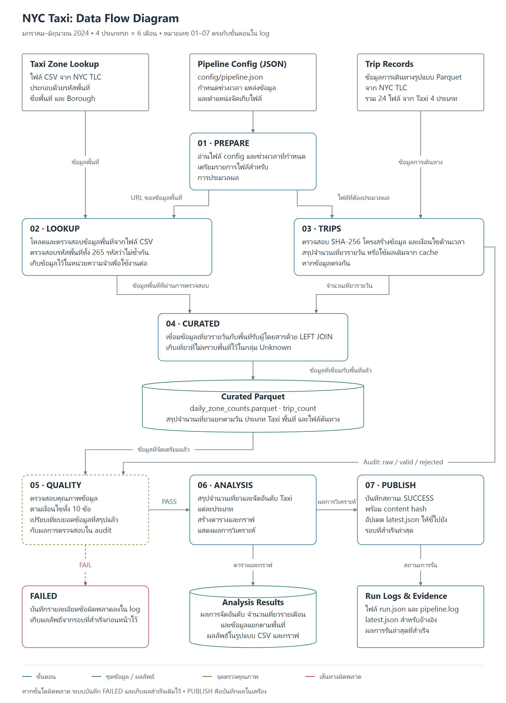

# CS341 Submission 2 — Reproducible NYC Taxi Data Pipeline
> **นาย รณกฤต วรลักษณ์ภักดี 6709650607**

โปรเจกต์นี้ต่อยอดจาก [Notebook ของ Submission 1](6709650607_Submission_1_CS341.ipynb) โดยพัฒนาจากการวิเคราะห์ข้อมูลใน Notebook ให้เป็น pipeline ที่สามารถรันซ้ำ ตรวจสอบคุณภาพข้อมูล และเก็บหลักฐานการทำงานไว้ตรวจสอบย้อนหลังได้ โดยยังคงตอบคำถามหลักจากงานเดิมว่า

> **Taxi ประเภทใดมีจำนวนเที่ยวเดินทางมากที่สุดในช่วงครึ่งแรกของปี 2024?**
>
> Which taxi type was the most used in the first half of 2024?

ระบบใช้ Python และ DuckDB ประมวลผลข้อมูลการเดินทางของ Taxi ทั้ง 4 ประเภท ตั้งแต่เดือนมกราคมถึงมิถุนายน 2024 จากนั้นนำข้อมูลมาเชื่อมกับตาราง Taxi Zone เพื่อเพิ่มรายละเอียดพื้นที่รับผู้โดยสาร และจัดเก็บผลลัพธ์ในรูปแบบที่พร้อมนำไปวิเคราะห์ต่อ โดยสรุปจำนวนเที่ยวแยกตามวัน ประเภท Taxi และพื้นที่รับผู้โดยสาร

ในการตอบคำถามนี้ จะนับเฉพาะรายการเดินทางที่ผ่านเกณฑ์ตรวจสอบข้อมูล (valid trip records) ส่วนคำว่า baseline หมายถึงผลลัพธ์จาก Submission 1 ซึ่งใช้เป็นข้อมูลอ้างอิงเพื่อเปรียบเทียบกับผลลัพธ์ของ pipeline ใหม่

## องค์ประกอบที่ส่งใน Submission 2

Repository นี้รวบรวมโค้ด เอกสารอธิบายการทำงาน และผลลัพธ์ที่ได้จากการประมวลผลจริง เพื่อให้ผู้ตรวจสามารถดูขั้นตอนการทำงาน ติดตั้งและรันระบบซ้ำ ตรวจสอบคุณภาพข้อมูล และเปรียบเทียบผลกับ Submission 1 ได้ โดยมีองค์ประกอบทั้งหมด 11 ข้อ ดังนี้
| ลำดับ | องค์ประกอบที่กำหนด | เนื้อหาและไฟล์ที่ใช้ตรวจ |
|---|---|---|
| 1 | Source Code และ Workflow ที่ใช้งานจริง | ประกอบด้วย [ไฟล์เริ่มต้นสำหรับรันระบบ](run_pipeline.py), [โค้ดส่วนต่าง ๆ ของ pipeline](taxi_pipeline/), [ไฟล์ตั้งค่า](config/pipeline.json) และ [workflow สำหรับทดสอบบน GitHub Actions](.github/workflows/ci.yml) |
| 2 | README อธิบายข้อมูล โครงสร้าง pipeline วิธีติดตั้ง และวิธีรัน | รายละเอียดอยู่ในหัวข้อ [ข้อมูลและกฎที่ใช้](#ข้อมูลและกฎที่ใช้), [ขั้นตอนการทำงาน](#pipeline-ทำอะไรบ้าง), [โครงสร้างโปรเจกต์](#โครงสร้างโปรเจกต์), [การติดตั้ง](#ติดตั้ง) และ [การรันกับข้อมูลจริง](#รัน-pipeline-กับข้อมูลจริง) |
| 3 | Pipeline / Data Flow Diagram | มี [แผนภาพ Data Flow ใน README](#data-flow-diagram) พร้อม [ภาพ PNG](docs/images/pipeline-data-flow.png), [ไฟล์ SVG](docs/images/pipeline-data-flow.svg) และ [ไฟล์ Mermaid](docs/pipeline.mmd) อธิบายการไหลของข้อมูลตั้งแต่รับข้อมูล ตรวจสอบและสรุปผล ไปจนถึงเชื่อมข้อมูลพื้นที่และสร้างผลวิเคราะห์ |
| 4 | หลักฐานการรัน pipeline และสถานะการทำงาน | เก็บ [สถานะและ log ของแต่ละรอบ](artifacts/runs/) ในไฟล์ `run.json`, `pipeline.log` และ `events.jsonl` รวมถึง [reproducibility.json](artifacts/reproducibility.json) ที่ใช้ยืนยันว่ารอบคำนวณใหม่กับรอบใช้ cache ให้ผลลัพธ์ตรงกัน; [ภาพแคปจากคอนโซลจริง 6 ภาพ](docs/evidence/README.md) |
| 5 | ตัวอย่างชุดข้อมูลพร้อมใช้สำหรับการวิเคราะห์ | มี [ไฟล์ CSV ตัวอย่าง 200 แถว](artifacts/curated/sample_daily_zone_counts.csv), [ชุดข้อมูล curated รูปแบบ Parquet จำนวน 153,662 แถว](artifacts/curated/daily_zone_counts.parquet) และ [คำอธิบายแต่ละคอลัมน์](docs/data_dictionary.md) |
| 6 | ผลการตรวจสอบคุณภาพข้อมูล | มี [รายงานตรวจสอบคุณภาพข้อมูล](artifacts/quality/quality.json) ซึ่งผ่านเกณฑ์ทั้ง 10 ข้อ และ [รายงาน audit แยกตามไฟล์](artifacts/quality/file_audit.csv) สำหรับตรวจสอบจำนวนข้อมูลดิบ ข้อมูลที่ผ่านเกณฑ์ และข้อมูลที่ถูกคัดออก |
| 7 | ผลวิเคราะห์ที่ตอบคำถามหลัก | มี [สรุปผลวิเคราะห์](artifacts/results/analysis.md), [ตารางจัดอันดับ](artifacts/results/ranking.csv) และ [กราฟเปรียบเทียบ](artifacts/results/taxi_usage.png) ซึ่งแสดงว่า High Volume FHV มีจำนวนเที่ยวที่ผ่านเกณฑ์มากที่สุดในช่วงครึ่งแรกของปี 2024 |
| 8 | การตัดสินใจออกแบบอย่างน้อย 2 ข้อ พร้อมเหตุผล | อธิบายการตัดสินใจออกแบบ 4 ข้อในหัวข้อ [พัฒนาจาก Submission 1 อย่างไร](#พัฒนาจาก-submission-1-อย่างไร) พร้อมเหตุผลและข้อแลกเปลี่ยนเพิ่มเติมใน [เอกสารการออกแบบ](docs/design.md) |
| 9 | สรุปการพัฒนาจาก Submission 1 และข้อจำกัดที่ยังมี | มี [ตารางเปรียบเทียบใน README](#พัฒนาจาก-submission-1-อย่างไร), [เอกสารเปรียบเทียบฉบับเต็ม](docs/baseline_comparison.md) และ [สรุปข้อจำกัดของระบบ](#ข้อจำกัดของ-pipeline-ปัจจุบัน) โดยจำนวนเที่ยวของ Taxi ทั้ง 4 ประเภทตรงกับ baseline |
| 10 | Learning Reflection ความยาว 3–5 ประโยค | มี [Reflection จำนวน 5 ประโยคใน README](#learning-reflection) และ [ไฟล์ Reflection แยกต่างหาก](docs/reflection.md) ซึ่งอธิบายการใช้ AI ช่วยพัฒนางานด้วย |
| 11 | ข้อจำกัดของ pipeline ปัจจุบัน | อธิบายไว้ใน [หัวข้อข้อจำกัดของ README](#ข้อจำกัดของ-pipeline-ปัจจุบัน) และ [เอกสารเพิ่มเติม](docs/baseline_comparison.md#ข้อจำกัดที่ยังมี) เช่น ข้อจำกัดของข้อมูลสรุป ข้อมูลพื้นที่ที่ขาดหาย การตรวจสอบคุณภาพ และการประมวลผลแบบ batch |

## ผลวิเคราะห์

**High Volume FHV มีจำนวนเที่ยวเดินทางมากที่สุด จำนวน 120,864,668 เที่ยว คิดเป็น 80.76% ของเที่ยวที่ผ่านเกณฑ์ทั้งหมด**

| อันดับ | ประเภท Taxi | จำนวนเที่ยวที่ผ่านเกณฑ์ | สัดส่วน |
|---|---|---:|---:|
| 1 | High Volume FHV | 120,864,668 | 80.76% |
| 2 | Yellow | 20,331,754 | 13.59% |
| 3 | FHV | 8,119,228 | 5.43% |
| 4 | Green | 339,801 | 0.23% |

จากข้อมูลดิบทั้งหมด **149,655,796 ระเบียน** มีข้อมูลที่ผ่านเกณฑ์ **149,655,451 ระเบียน** และถูกคัดออก **345 ระเบียน** เมื่อนำผลลัพธ์ไปเปรียบเทียบกับ baseline พบว่าจำนวนเที่ยวตรงกันทั้ง 4 ประเภท โดยไม่มีส่วนต่าง ดูรายละเอียดได้จาก [ตารางเปรียบเทียบ](artifacts/results/baseline_comparison.csv)


ชุดข้อมูลที่เตรียมไว้สำหรับวิเคราะห์มี **153,662 แถว** โดยแต่ละแถวเป็นข้อมูลสรุปของหนึ่งกลุ่ม หากต้องการคำนวณจำนวนเที่ยวทั้งหมด ต้องนำค่า `trip_count` มารวมกัน สามารถดูรายละเอียดเพิ่มเติมได้จาก [ผลวิเคราะห์ฉบับเต็ม](artifacts/results/analysis.md) และ [ตารางจัดอันดับ](artifacts/results/ranking.csv)

## ติดตั้ง

ก่อนเริ่มใช้งาน ให้ติดตั้ง **Python 3.13** (เวอร์ชันที่ใช้ทดสอบโปรเจกต์นี้) และ Git หากต้องการประมวลผลข้อมูลดิบทั้งหมด ควรเตรียมพื้นที่ว่างอย่างน้อย 8 GiB โดยข้อมูลดิบที่ใช้มีขนาดรวมประมาณ 3.12 GiB

```bash
git clone https://github.com/ronnakrit303/CS341-Submission2.git
cd CS341-Submission2
python -m venv .venv
```

**Windows PowerShell:** ใช้ Python ภายใน virtual environment เพื่อติดตั้งแพ็กเกจและตรวจสอบการทำงานได้โดยตรง

```powershell
.\.venv\Scripts\python.exe -m pip install -r requirements-dev.txt
.\.venv\Scripts\python.exe -m pytest -v
.\.venv\Scripts\python.exe scripts/verify_artifacts.py
```

**Linux/macOS:** เปิดใช้งาน virtual environment ก่อนติดตั้งแพ็กเกจและทดสอบ

```bash
source .venv/bin/activate
python -m pip install -r requirements-dev.txt
python -m pytest -v
python scripts/verify_artifacts.py
```

ตัวอย่างคำสั่งในหัวข้อถัดไปจะใช้ `python` จาก environment ที่ติดตั้ง dependencies แล้ว สำหรับ Windows หากยังไม่ได้เปิดใช้งาน `.venv` ให้ใช้ `.\.venv\Scripts\python.exe` แทน `python`

ไฟล์ `requirements.txt` ระบุแพ็กเกจที่จำเป็นสำหรับรัน pipeline ส่วน `requirements-dev.txt` รวมแพ็กเกจสำหรับใช้งานและ `pytest` สำหรับทดสอบระบบ

## ตรวจสอบผลงานจากไฟล์ใน Repository

ในโฟลเดอร์ `artifacts/` มีทั้ง [ชุดข้อมูล curated รูปแบบ Parquet ฉบับเต็ม](artifacts/curated/daily_zone_counts.parquet), [CSV ตัวอย่าง 200 แถว](artifacts/curated/sample_daily_zone_counts.csv), ผลวิเคราะห์ และหลักฐานจากการรันจริง จึงสามารถตรวจสอบผลงานส่วนนี้ได้โดยไม่จำเป็นต้องดาวน์โหลดข้อมูลดิบทั้งหมด

```bash
python -m pytest -v
python scripts/verify_artifacts.py
```

| คำสั่ง | สิ่งที่ตรวจ | ผลที่คาดหวังในรุ่นปัจจุบัน |
|---|---|---|
| `python -m pytest -v` | ทดสอบการทำงานของ pipeline ด้วยข้อมูลจำลองขนาดเล็ก | บน Windows: `31 passed` |
| `python scripts/verify_artifacts.py` | ตรวจสอบไฟล์หลักฐานและความสอดคล้องของผลลัพธ์ที่แนบมา | `PASS` |

ชุดทดสอบครอบคลุมทั้งโครงสร้างคอลัมน์ กฎคัดกรอง การเชื่อมข้อมูลพื้นที่ การใช้ cache การเพิ่มเดือน การเปลี่ยนแปลงของข้อมูลต้นทาง และการจัดการเมื่อพบข้อมูลผิดพลาด รวมถึงการรักษาผลลัพธ์รอบล่าสุดที่สำเร็จไว้ หากการรันรอบใหม่ล้มเหลว ดูรายละเอียดใน [ชุดทดสอบ pipeline](tests/test_pipeline.py) และ [ชุดทดสอบการล็อกไฟล์](tests/test_atomic_files.py) โดยมีหนึ่งกรณีที่ทดสอบการล็อกไฟล์จริงบน Windows และจะข้ามกรณีนี้เมื่อรันบนระบบปฏิบัติการอื่น

สคริปต์ตรวจสอบหลักฐานจะตรวจขนาดไฟล์และค่าแฮช SHA-256 ว่าตรงกับข้อมูลที่บันทึกไว้หรือไม่ จากนั้นคำนวณยอดรวมจากชุดข้อมูล curated อีกครั้ง เพื่อนำไปเทียบกับตารางจัดอันดับและรายงาน audit ของแต่ละไฟล์ พร้อมตรวจสอบหลักฐานการรันซ้ำ โดยผลจากหลักฐานที่แนบไว้เป็นดังนี้

```text
PASS: 47 artifact hashes; 24 source audits; 149,655,451 valid trip records; unchanged rerun verified
```

หากต้องการทดสอบเฉพาะการอัปเดตข้อมูลและการจัดการข้อผิดพลาด สามารถใช้คำสั่งนี้

```bash
python -m pytest -v -k "added_month or refresh_changed or failed_refresh or all_invalid or publish_failure"
```

ผลที่คาดหวังคือ `7 passed, 24 deselected` หมายถึงผ่าน 7 กรณี และไม่ได้เลือกอีก 24 กรณีมาทดสอบ โดยใช้ข้อมูลขนาดเล็กใน `tmp/pytest-runs/` ซึ่งแยกจากข้อมูลจริง บางกรณีตั้งใจจำลองให้ pipeline หยุดทำงาน เพื่อยืนยันว่าระบบสามารถตรวจพบปัญหาและจัดการได้ตามที่กำหนด

GitHub Actions จะรันชุดทดสอบและสคริปต์ตรวจสอบหลักฐานให้อัตโนมัติ สามารถดู [ผลการทดสอบบน GitHub](https://github.com/ronnakrit303/CS341-Submission2/actions) ได้ โดย workflow ใช้ข้อมูลทดสอบขนาดเล็กและไฟล์ใน `artifacts/` ส่วนหลักฐานจากการประมวลผลข้อมูลดิบทั้งหมดเก็บไว้ใน [ประวัติการรัน](artifacts/runs/)

### ภาพแคปจากการรันจริง

ดู [ภาพหลักฐานทั้ง 6 ภาพ](docs/evidence/README.md) จากการรันบน Windows วันที่ 15 พฤศจิกายน 2569 โดยใช้ข้อมูลดิบในเครื่องครบ 24 ไฟล์ มีภาพ tests ผ่าน 31 ข้อ รอบคำนวณใหม่ รอบใช้ cache ผลตรวจคุณภาพ การเทียบ hash และผลตรวจ artifacts พร้อม log และข้อมูลกำกับของแต่ละคำสั่ง ชุดภาพนี้รันโดยมี Codex ช่วยเรียกคำสั่งและแคปหน้าต่างคอนโซลจริง

## รัน pipeline กับข้อมูลจริง

### รันครั้งแรก

```bash
python run_pipeline.py
```

เมื่อรันคำสั่ง ระบบจะอ่าน [ไฟล์ตั้งค่า](config/pipeline.json) ดาวน์โหลดข้อมูลที่ยังไม่มีในเครื่อง ตรวจสอบข้อมูล สร้าง curated output และสรุปผลการวิเคราะห์ โดยค่าเริ่มต้นใช้ข้อมูล Taxi 4 ประเภท เป็นเวลา 6 เดือน รวมไฟล์ Parquet 24 ไฟล์ และไฟล์ CSV สำหรับตารางพื้นที่อีก 1 ไฟล์

### ตรวจว่ารันซ้ำแล้วได้ผลเดิม

หลังจากดาวน์โหลดข้อมูลดิบครบแล้ว สามารถตรวจสอบว่าระบบรันซ้ำและได้ผลลัพธ์เดิมหรือไม่ด้วยคำสั่งต่อไปนี้ตามลำดับ

```bash
python run_pipeline.py --offline --rebuild
python run_pipeline.py --offline
```

ตัวเลือก `--offline` จะใช้เฉพาะข้อมูลดิบที่เก็บไว้ในเครื่อง โดยตรวจสอบค่าแฮชก่อนอ่านและไม่ดาวน์โหลดข้อมูลผ่าน HTTP ส่วน `--rebuild` จะบังคับให้คำนวณผลสรุปใหม่แทนการใช้ cache จากการรันครั้งก่อน

| สิ่งที่ตรวจ | รอบ `--offline --rebuild` | รอบ `--offline` |
|---|---|---|
| สถานะ | SUCCESS ครบ 7/7 ขั้นตอน | SUCCESS ครบ 7/7 ขั้นตอน |
| การคำนวณข้อมูลเที่ยวรถ | `processed=24`, `reused=0` | `processed=0`, `reused=24` |
| จำนวนเที่ยวที่ผ่านกฎ | 149,655,451 | 149,655,451 |
| จำนวนแถวใน curated | 153,662 | 153,662 |
| Run ID | รหัสเฉพาะของรอบแรก | รหัสเฉพาะของรอบที่สอง |

เปิดไฟล์ `reports/runs/<run_id>/run.json` ของทั้งสองรอบ แล้วเปรียบเทียบค่า `curated_content_sha256` ซึ่งเป็นค่าแฮชที่คำนวณจากเนื้อหา curated ในลำดับที่กำหนดไว้ หากค่าแฮชตรงกัน แสดงว่าเนื้อหาผลลัพธ์ทั้งสองรอบเหมือนกัน โดยมีหลักฐานการเปรียบเทียบอยู่ใน [reproducibility.json](artifacts/reproducibility.json)

### อัปเดตข้อมูลหรือเปลี่ยนช่วงเวลา

```bash
# ดาวน์โหลดข้อมูลใหม่อีกครั้ง เพื่อตรวจว่าข้อมูลต้นทางมีการเปลี่ยนแปลงหรือไม่
python run_pipeline.py --refresh

# ตัวอย่างเพิ่มเดือนกรกฎาคม 2024
python run_pipeline.py --start-month 2024-01 --end-month 2024-07
```

โดยปกติระบบจะใช้ไฟล์ที่มีอยู่แล้ว หากตรวจสอบค่าแฮชผ่าน และดาวน์โหลดเฉพาะไฟล์ที่ยังไม่มีหรือใช้ไม่ได้ หากต้องการตรวจสอบว่าข้อมูลจากแหล่งต้นทางมีการเปลี่ยนแปลงหรือไม่ ให้ใช้ `--refresh` ซึ่งไม่สามารถใช้ร่วมกับ `--offline` ได้

เมื่อขยายช่วงเดือน ระบบจะปรับช่วงวันที่ที่ใช้ตรวจสอบข้อมูล และคำนวณไฟล์เดิมใหม่ พร้อมรับข้อมูลของเดือนที่เพิ่มเข้ามา ผลการวิเคราะห์จะแสดงช่วงเวลาที่เลือกไว้อย่างชัดเจน ทั้งนี้ คำตอบหลักของโปรเจกต์ยังอ้างอิงข้อมูลเดือนมกราคม–มิถุนายน 2024 สามารถปรับช่วงเดือน ตำแหน่งไฟล์ และการใช้ทรัพยากรได้ใน [config/pipeline.json](config/pipeline.json)

## Pipeline ทำอะไรบ้าง

pipeline แบ่งการทำงานออกเป็น **7 ขั้นตอน** ตามลำดับดังนี้

| ขั้น | ชื่อใน log | การทำงาน |
|---|---|---|
| 1/7 | PREPARE | เตรียมระบบ รายการไฟล์ที่ต้องใช้ และโฟลเดอร์สำหรับการรันครั้งนี้ |
| 2/7 | LOOKUP | ดาวน์โหลดหรือตรวจสอบไฟล์ CSV ของพื้นที่ รวมถึงตรวจคอลัมน์และรหัสพื้นที่ไม่ให้ซ้ำกัน |
| 3/7 | TRIPS | ตรวจสอบหรือดาวน์โหลดไฟล์ Parquet แล้วคำนวณผลสรุปใหม่หรือใช้ผลเดิมจาก cache |
| 4/7 | CURATED | รวมข้อมูลสรุป เชื่อมรายละเอียดพื้นที่ และบันทึกชุดข้อมูลที่พร้อมวิเคราะห์ |
| 5/7 | QUALITY | ตรวจสอบคุณภาพและความถูกต้องของยอดข้อมูล พร้อมแจ้งข้อควรระวัง |
| 6/7 | ANALYSIS | สร้างตารางจัดอันดับ ผลสรุปรายเดือนและรายพื้นที่ กราฟ และตัวอย่าง CSV |
| 7/7 | PUBLISH | บันทึกสถานะเมื่อรันสำเร็จ พร้อมระบุตำแหน่งผลลัพธ์ล่าสุดในเครื่อง |

### Data Flow Diagram

แผนภาพด้านล่างแสดงการไหลของข้อมูล ตั้งแต่รับข้อมูลเที่ยวรถและตารางพื้นที่ ไปจนถึงการตรวจสอบคุณภาพ สร้างผลวิเคราะห์ และบันทึกสถานะเมื่อทำงานสำเร็จ หมายเลข **01–07** ตรงกับขั้นตอนใน log โดยระบบรันตามลำดับหมายเลข ส่วนลูกศรแสดงข้อมูลที่ส่งต่อระหว่างขั้นตอน



[เปิดภาพ PNG ขนาดเต็ม](docs/images/pipeline-data-flow.png) · [เปิดไฟล์ SVG](docs/images/pipeline-data-flow.svg) · [เปิดฉบับ Mermaid](docs/pipeline.mmd)

- **กรอบสีเทา:** ข้อมูลต้นทาง CSV, Parquet และไฟล์ตั้งค่า JSON
- **กรอบสีน้ำเงิน:** ขั้นตอนประมวลผล พร้อมคำอธิบายภายในกล่อง
- **กรอบเส้นประสีเหลือง:** ขั้น QUALITY ซึ่งตรวจคุณภาพ 10 เงื่อนไขก่อนส่งต่อไปวิเคราะห์
- **กรอบสีเขียว:** ชุดข้อมูล curated ผลวิเคราะห์ และหลักฐานการรัน โดยใช้ทรงกระบอกแทนชุดข้อมูลที่จัดเก็บ
- **เส้นประสีแดง:** เส้นทาง `FAIL` ไปยังสถานะ `FAILED` ซึ่งบันทึกข้อผิดพลาดและคงผลสำเร็จของรอบก่อน

ขั้น TRIPS สรุปจำนวนเที่ยวรายวัน หรือใช้ผลเดิมจาก cache เมื่อข้อมูลและเงื่อนไขตรงกัน เส้น Audit ส่งยอด `raw / valid / rejected` ให้ขั้น QUALITY เปรียบเทียบกับข้อมูลที่จัดเตรียมแล้ว เมื่อผ่าน (`PASS`) จึงสร้างผลการวิเคราะห์และบันทึกสถานะสำเร็จ หากเกิดข้อผิดพลาดในขั้นตอนอื่น ระบบจะบันทึก `FAILED` และเก็บผลลัพธ์จากรอบที่สำเร็จก่อนหน้าไว้ ทั้งนี้ PUBLISH คือการบันทึกผลในเครื่อง ส่วนการส่งออกหลักฐานขึ้น GitHub ทำแยกหลังรันสำเร็จ

ภาพใน README ใช้ PNG เพื่อให้ฟอนต์และหน้าตาแสดงตรงกันบน GitHub หากต้องการปรับข้อความ สี หรือตำแหน่งกล่อง ให้แก้ [สคริปต์สร้างแผนภาพ](scripts/render_pipeline_diagram.py) แล้วรันคำสั่งด้านล่างเพื่อสร้าง SVG และ Mermaid จากข้อมูลชุดเดียวกันด้วย Python มาตรฐาน จากนั้นส่งออก SVG เป็น PNG ใหม่เพื่ออัปเดตภาพใน README

```bash
python scripts/render_pipeline_diagram.py
```

### อ่านสถานะจาก log

ระหว่างรัน pipeline สามารถติดตามความคืบหน้าได้จากข้อความใน Terminal ซึ่งจะถูกบันทึกลงใน `pipeline.log` ของแต่ละรอบด้วย โดยช่วงเริ่มต้นจะแสดง Run ID ช่วงข้อมูล โหมดการทำงาน และรายชื่อทั้ง 7 ขั้นตอน จากนั้นใช้ลูกศร `↓` เชื่อมลำดับการทำงานให้อ่านจากบนลงล่างได้ง่ายขึ้น

- `[STEP 03/07]` หมายถึงกำลังแสดงขั้นตอนที่ 3 จากทั้งหมด 7 ขั้นตอน
- `[FILE 05/24]` หมายถึงไฟล์ลำดับที่ 5 จากทั้งหมด 24 ไฟล์ในขั้น TRIPS
- `RUNNING` หมายถึงกำลังทำงาน ส่วน `OK` หมายถึงขั้นตอนนั้นเสร็จสมบูรณ์
- `PROCESSED` หมายถึงมีการคำนวณข้อมูลไฟล์นั้นใหม่ ส่วน `REUSED` หมายถึงนำผลคำนวณเดิมจาก cache มาใช้ เพราะข้อมูลและเงื่อนไขยังตรงกัน
- `WARN` หมายถึงข้อควรระวัง เช่น รายการ FHV ที่ไม่มีข้อมูลพื้นที่รับผู้โดยสาร ซึ่งยังคงถูกนับรวมในจำนวนเที่ยวทั้งหมด
- `FAILED` หมายถึงการรันรอบนั้นไม่สำเร็จ ส่วนขั้นตอนที่ยังไม่ได้ทำจะแสดง `SKIPPED`

เมื่อรันเสร็จ log จะสรุปสถานะ ระยะเวลาที่ใช้ จำนวนข้อมูล และตำแหน่งผลลัพธ์ หากขึ้น `Status: SUCCESS` หมายถึงระบบทำงานสำเร็จและจบด้วย exit code 0 แต่หากขึ้น `Status: FAILED` จะจบด้วย exit code 1 โดยขั้น PUBLISH จะบันทึกผลไว้ในเครื่อง ส่วนการส่งออกหลักฐานและอัปโหลดขึ้น GitHub ต้องดำเนินการแยกภายหลัง

สามารถดูตัวอย่างจาก [log รอบที่คำนวณใหม่](artifacts/runs/20261115T003121Z-ad4d1e72/pipeline.log) และ [log รอบที่ใช้ cache](artifacts/runs/20261115T003150Z-bb92cece/pipeline.log) โดยเวลาที่บันทึกในหลักฐานเป็น UTC ซึ่งช้ากว่าเวลาไทย 7 ชั่วโมง

หาก Windows ล็อกไฟล์ชั่วคราวขณะระบบกำลังแทนที่ไฟล์ pipeline จะลองดำเนินการซ้ำตามจำนวนครั้งที่กำหนด หากยังไม่สำเร็จจะบันทึกสถานะ `FAILED` โดยไม่เปลี่ยนตำแหน่งผลลัพธ์รอบล่าสุดที่สำเร็จ ทั้งกรณีล็อกไฟล์ชั่วคราวและกรณีที่ต้องหยุดทำงานมีชุดทดสอบรองรับ

## ข้อมูลและกฎที่ใช้

โปรเจกต์นี้ใช้ข้อมูลจาก [NYC TLC Trip Record Data](https://www.nyc.gov/site/tlc/about/tlc-trip-record-data.page) โดยแบ่งเป็น **ข้อมูล 2 ชุดที่เผยแพร่โดย NYC TLC แต่จัดเก็บคนละรูปแบบ** ดังนี้

| ชุดข้อมูล | รูปแบบ | ใช้ทำอะไร |
|---|---|---|
| Trip Records: Yellow, Green, FHV และ High Volume FHV | Parquet จำนวน 24 ไฟล์ | ตรวจสอบเวลาและนับจำนวนเที่ยว แยกตามวัน ประเภท Taxi และรหัสพื้นที่รับผู้โดยสาร |
| Taxi Zone Lookup | CSV จำนวน 1 ไฟล์ | ใช้รหัสพื้นที่เพื่อเพิ่มชื่อพื้นที่ Borough และ Service Zone |

ไฟล์ข้อมูลเที่ยวรถดาวน์โหลดได้จาก URL รูปแบบ `https://d37ci6vzurychx.cloudfront.net/trip-data/{prefix}_tripdata_{YYYY-MM}.parquet` โดย `{prefix}` แทน `yellow`, `green`, `fhv` หรือ `fhvhv` ส่วนข้อมูลพื้นที่ใช้ไฟล์ [Taxi Zone Lookup CSV](https://d37ci6vzurychx.cloudfront.net/misc/taxi_zone_lookup.csv)

รายละเอียดของไฟล์ต้นทางทั้ง 25 ไฟล์เก็บไว้ใน [source manifest](artifacts/provenance/manifest.json) โดยบันทึก URL ขนาดไฟล์ ค่า SHA-256 และเวลาที่รับข้อมูล ส่วนคำอธิบายคอลัมน์ของแต่ละประเภทสามารถดูได้จากเอกสาร TLC ได้แก่ [Yellow](https://www.nyc.gov/assets/tlc/downloads/pdf/data_dictionary_trip_records_yellow.pdf), [Green](https://www.nyc.gov/assets/tlc/downloads/pdf/data_dictionary_trip_records_green.pdf), [FHV](https://www.nyc.gov/assets/tlc/downloads/pdf/data_dictionary_trip_records_fhv.pdf) และ [High Volume FHV](https://www.nyc.gov/assets/tlc/downloads/pdf/data_dictionary_trip_records_hvfhs.pdf)

### กฎคัดกรองและการตรวจคุณภาพ

ระบบใช้เกณฑ์คัดกรองเดียวกับ Submission 1 โดยหากรายการใดไม่ผ่านหลายเงื่อนไข จะบันทึกเฉพาะเหตุผลแรกที่พบ เพื่อไม่ให้นับรายการเดียวซ้ำหลายครั้ง ได้แก่

1. ไม่มีเวลาเริ่มเที่ยว หรือไม่สามารถแปลงค่าเป็นเวลาได้
2. ไม่มีเวลาสิ้นสุดเที่ยว หรือไม่สามารถแปลงค่าเป็นเวลาได้
3. เวลาเริ่มเที่ยวอยู่นอกช่วงเวลาที่กำหนดไว้สำหรับวิเคราะห์
4. เวลาสิ้นสุดเที่ยวอยู่ก่อนเวลาเริ่มเที่ยว

กรณีที่ระยะทางเท่ากับศูนย์ ค่าโดยสารติดลบ ไม่มีข้อมูลจำนวนผู้โดยสาร หรืออาจมีรายการซ้ำ ระบบจะบันทึกไว้เป็นข้อมูลประกอบการตรวจสอบ แต่ไม่ได้ใช้เป็นเหตุผลในการคัดออก สำหรับการตรวจรายการที่อาจซ้ำ จะตรวจเฉพาะ 10,000 แถวแรกของแต่ละไฟล์ และยังไม่ได้ตรวจยืนยันหรือลบรายการซ้ำจากข้อมูลทั้งชุด

ก่อนเชื่อมข้อมูลพื้นที่ ระบบจะตรวจสอบว่ารหัสพื้นที่ในตาราง lookup ไม่มีค่าซ้ำ แล้วใช้ `LEFT JOIN` เพื่อเก็บรายการเดินทางที่ไม่สามารถระบุพื้นที่ได้ไว้ด้วย จากนั้นตรวจสอบคุณภาพข้อมูลทั้งหมด 10 ข้อ ครอบคลุมความครบถ้วนของไฟล์และคอลัมน์ จำนวนรายการที่คัดออก ความสัมพันธ์ `raw = valid + rejected` ยอดรวมใน curated จำนวนเที่ยวก่อนและหลัง join ความไม่ซ้ำของกลุ่มข้อมูลสรุป จำนวนเที่ยวที่ต้องเป็นค่าบวก และวันที่ที่ต้องอยู่ในช่วงวิเคราะห์

ผลการตรวจสอบข้อมูลจริงผ่านเกณฑ์ทั้ง 10 ข้อ โดยดูได้จาก [รายงานคุณภาพข้อมูล](artifacts/quality/quality.json) และ [รายงาน audit แยกตามไฟล์](artifacts/quality/file_audit.csv) ส่วนรายละเอียดของเกณฑ์และคอลัมน์ต่าง ๆ อธิบายไว้ใน [data dictionary](docs/data_dictionary.md)

## การนำผลลัพธ์ไปใช้และตรวจสอบย้อนกลับ

ชุดข้อมูล curated เป็นข้อมูลที่สรุปตาม **วันที่รับผู้โดยสาร × ประเภท Taxi × รหัสพื้นที่รับผู้โดยสาร × ไฟล์ต้นทาง** โดยเก็บทั้งชื่อพื้นที่และจำนวนเที่ยวไว้ในคอลัมน์ `trip_count` นอกจากนี้ยังเก็บชื่อไฟล์ต้นทาง เพื่อให้สามารถตรวจสอบย้อนหลังเทียบกับรายงาน audit ได้

ตัวอย่างการอ่านข้อมูลฉบับเต็มและรวมจำนวนเที่ยวด้วย Python

```python
import duckdb

with duckdb.connect() as con:
    result = con.execute("""
        SELECT taxi_type, SUM(trip_count) AS valid_records
        FROM read_parquet('artifacts/curated/daily_zone_counts.parquet')
        GROUP BY taxi_type
        ORDER BY valid_records DESC
    """).fetchall()
    print(result)
```

ไฟล์ CSV จำนวน 200 แถวจัดเตรียมไว้เพื่อให้เห็นตัวอย่างโครงสร้างข้อมูล ส่วนผลวิเคราะห์ที่ใช้ตอบคำถามหลักคำนวณจากไฟล์ Parquet ฉบับเต็ม

| ตำแหน่ง | สิ่งที่เก็บ |
|---|---|
| `artifacts/curated/` | ชุดข้อมูล curated รูปแบบ Parquet ฉบับเต็ม และไฟล์ CSV ตัวอย่างที่แนบไว้ใน Repository |
| `artifacts/results/` | ตารางจัดอันดับ ผลสรุปรายเดือนและรายพื้นที่ กราฟ และผลเปรียบเทียบ baseline |
| `artifacts/quality/` | รายงานตรวจสอบคุณภาพข้อมูลและ audit ของแต่ละไฟล์ต้นทาง |
| `artifacts/provenance/` | ข้อมูลแหล่งที่มา ค่าแฮช และไฟล์ตั้งค่าที่ใช้ในการประมวลผล |
| `artifacts/runs/` | สถานะและ log ของการรันแต่ละรอบที่เก็บไว้เป็นหลักฐาน |
| `data/curated/<run_id>/` | ผลลัพธ์ curated ของแต่ละรอบที่รันในเครื่อง |
| `reports/runs/<run_id>/` | รายงาน audit, quality, analysis และ log ของแต่ละรอบที่สร้างในเครื่อง |
| `reports/latest.json` | ข้อมูลตำแหน่งผลลัพธ์ล่าสุดที่รันสำเร็จในเครื่อง |

ไฟล์ `run.json` บันทึกการตั้งค่า เวอร์ชันแพ็กเกจ ค่าแฮชของโค้ด สถานะของแต่ละขั้นตอน และผลสรุปการทำงาน ส่วน `events.jsonl` บันทึกเหตุการณ์พร้อมเวลาในรูปแบบที่โปรแกรมอ่านได้ หากการรันครั้งใหม่ล้มเหลว ไฟล์ `reports/latest.json` จะยังคงอ้างอิงผลลัพธ์จากรอบล่าสุดที่สำเร็จ

ข้อมูลดิบใน `data/raw/`, cache ใน `data/cache/` และไฟล์ผลลัพธ์ที่สร้างระหว่างรันถูกกำหนดให้ Git ไม่ติดตาม ดังนั้นไฟล์ที่ส่งให้ผู้ตรวจผ่าน GitHub จะอยู่ใน `artifacts/` ซึ่งแยกจากผลลัพธ์ที่สร้างไว้ในเครื่อง

เมื่อรันครบสองรอบและยืนยันแล้วว่าได้ผลลัพธ์ตรงกัน หากต้องการอัปเดตหลักฐานใน `artifacts/` ให้ใช้คำสั่งต่อไปนี้

```bash
python scripts/export_evidence.py
python scripts/verify_artifacts.py
```

สคริปต์ export จะตรวจสอบว่าทั้งสองรอบรันสำเร็จภายใต้การตั้งค่าและโค้ดเดียวกัน มีจำนวนเที่ยวและเนื้อหาข้อมูล curated ตรงกัน รวมถึงยืนยันว่ารอบล่าสุดใช้ cache ครบทุกไฟล์ จากนั้นจึงคัดลอกหลักฐานไปยัง `artifacts/` ในเครื่อง หากต้องการเผยแพร่หลักฐานชุดใหม่บน GitHub ต้อง commit และ push ไฟล์เหล่านี้ด้วย สามารถอ่านรายละเอียดเพิ่มเติมได้จาก [คู่มือไฟล์หลักฐาน](artifacts/README.md)

## โครงสร้างโปรเจกต์

```text
run_pipeline.py                จุดเริ่มต้นสำหรับสั่งรัน pipeline
config/pipeline.json            ช่วงเดือน แหล่งข้อมูล และการใช้ทรัพยากร
taxi_pipeline/                 โค้ดรับข้อมูล ตรวจสอบ สรุป เชื่อม และสร้างรายงาน
baseline/expected_counts.json   ผล Submission 1 สำหรับเปรียบเทียบ
tests/                         ชุดทดสอบด้วยข้อมูลขนาดเล็ก
conftest.py                    แยกโฟลเดอร์ชั่วคราวของการทดสอบแต่ละรอบ
.github/workflows/ci.yml        ทดสอบอัตโนมัติบน GitHub Actions
scripts/                       สคริปต์ส่งออกและตรวจหลักฐาน
docs/                          แผนภาพ พจนานุกรมข้อมูล การออกแบบ และ Reflection
artifacts/                     ชุดข้อมูล ผลวิเคราะห์ และหลักฐานที่ส่งตรวจ
data/                          ข้อมูลดิบ cache และ curated ที่สร้างในเครื่อง
reports/                       สถานะและผลรันที่สร้างในเครื่อง
```

ไฟล์ Notebook เดิม `6709650607_Submission_1_CS341.ipynb` ยังคงเก็บไว้ในโฟลเดอร์หลัก เพื่อใช้อ้างอิงและเปรียบเทียบกับ Submission 1

## พัฒนาจาก Submission 1 อย่างไร

| ส่วนงาน | Submission 1 | Submission 2 |
|---|---|---|
| วิธีรัน | รันทีละ cell ภายใน Notebook | รันผ่าน CLI และกำหนดช่วงข้อมูลด้วยไฟล์ config |
| ข้อมูล | ใช้ข้อมูลเที่ยวรถรูปแบบ Parquet | เพิ่ม CSV ของ Taxi Zone และนำมาเชื่อมกับข้อมูลเที่ยวรถ |
| ผลลัพธ์ที่จัดเก็บ | แสดงผลสรุปภายใน Notebook | จัดเก็บ curated Parquet, CSV ตัวอย่าง และรายงานแยกเป็นไฟล์ |
| การรันซ้ำ | คำนวณ audit ใหม่ใน Notebook | ตรวจสอบค่าแฮชและใช้ cache เมื่อข้อมูลกับเงื่อนไขไม่เปลี่ยน |
| การตรวจสอบ | ตรวจผลลัพธ์จากแต่ละ cell | มีรายงานคุณภาพข้อมูล log รายขั้นตอน ชุดทดสอบ และหลักฐานการรัน |

แม้จะเปลี่ยนจาก Notebook มาเป็น pipeline แต่ระบบยังใช้เกณฑ์คัดกรองและวิธีนับจำนวนเที่ยวเหมือน Submission 1 จึงสามารถเปรียบเทียบผลลัพธ์กันได้โดยตรง ดูรายละเอียดใน [เอกสารเปรียบเทียบฉบับเต็ม](docs/baseline_comparison.md)

การออกแบบระบบมีการตัดสินใจหลัก 4 ข้อ ได้แก่

1. **ใช้ DuckDB และจัดเก็บผลสรุปรายวัน** เพื่อรองรับการประมวลผลข้อมูลจำนวนมาก และลดขนาดผลลัพธ์ให้สะดวกต่อการเก็บบน GitHub โดยยังนับทุกเที่ยวที่ผ่านเกณฑ์
2. **ใช้เกณฑ์คัดกรองและตัวชี้วัดเดิม** เพื่อให้สามารถเปรียบเทียบผลลัพธ์กับ Submission 1 ได้อย่างตรงไปตรงมา
3. **ใช้ LEFT JOIN และเก็บรายการที่ไม่ทราบพื้นที่ไว้ในกลุ่ม Unknown** เพื่อไม่ให้จำนวนเที่ยวลดลงเพียงเพราะไม่มีข้อมูลพื้นที่
4. **แยกผลลัพธ์ของการรันแต่ละรอบ** และอัปเดตตำแหน่งผลลัพธ์ล่าสุดเฉพาะเมื่อรันสำเร็จ เพื่อป้องกันไม่ให้รอบที่ล้มเหลวไปแทนที่ผลลัพธ์เดิม

รายละเอียดเหตุผล ข้อแลกเปลี่ยนในการออกแบบ และแนวทางจัดการ cache อยู่ใน [เอกสารการออกแบบ](docs/design.md)

## ข้อจำกัดของ pipeline ปัจจุบัน

- **ข้อมูล curated เป็นข้อมูลสรุป** จึงไม่สามารถนำไปวิเคราะห์รายละเอียดรายเที่ยว เช่น การกระจายตัวของค่าโดยสารหรือระยะเวลาเดินทางแต่ละเที่ยวได้
- **ข้อมูลพื้นที่ของ FHV ยังไม่ครบถ้วน** โดยมี 6,359,783 เที่ยวที่ไม่มีรหัสพื้นที่รับผู้โดยสารที่ใช้งานได้ ระบบยังคงนับเที่ยวเหล่านี้ในกลุ่ม Unknown จึงมีข้อจำกัดเมื่อต้องวิเคราะห์แยกตามพื้นที่
- **การตรวจสอบคุณภาพยังมีขอบเขตจำกัด** โดยตรวจเฉพาะเงื่อนไขที่กำหนดไว้ ความถูกต้องด้านอื่นยังขึ้นอยู่กับข้อมูลต้นทาง และระบบยังไม่ได้ตรวจยืนยันหรือลบรายการซ้ำจากข้อมูลทั้งหมด
- **ตัวชี้วัดเป็นจำนวนรายการเดินทาง** จึงไม่สามารถใช้สรุปจำนวนผู้โดยสารที่ไม่ซ้ำกัน รายได้ หรือสาเหตุที่ Taxi ประเภทหนึ่งได้รับความนิยมมากกว่าอีกประเภทได้โดยตรง
- **ระบบประมวลผลแบบ batch บนเครื่องเดียว** โดยต้องสั่งรันด้วยตนเอง และจะตรวจสอบการเปลี่ยนแปลงของข้อมูลต้นทางเมื่อใช้ `--refresh`

สามารถอ่าน [รายละเอียดข้อจำกัดเพิ่มเติม](docs/baseline_comparison.md#ข้อจำกัดที่ยังมี) ได้จากเอกสารเปรียบเทียบกับ Submission 1

## Learning Reflection

การพัฒนาจาก Submission 1 มาเป็น pipeline ทำให้ผมเข้าใจว่าการวิเคราะห์ข้อมูลไม่ได้จบแค่ได้คำตอบ แต่ต้องมีหลักฐานให้ตรวจสอบได้ด้วยว่าผลลัพธ์มาจากข้อมูลและขั้นตอนใด เมื่อทดลองรัน `--offline --rebuild` แล้วตามด้วย `--offline` ผมพบว่ารอบแรกประมวลผลใหม่ทั้ง 24 ไฟล์ ส่วนรอบถัดไปนำ cache มาใช้ได้ครบ โดยยังได้จำนวนเที่ยวและค่าแฮชของผลลัพธ์ตรงกัน การปรับ log ให้แสดงการทำงานทั้ง 7 ขั้นตอนพร้อมสถานะและลูกศรเชื่อมลำดับ ช่วยให้ผมติดตามได้ง่ายขึ้นว่าระบบกำลังทำอะไรและเกิดปัญหาที่ขั้นตอนไหน ระหว่างทดสอบ ผมยังพบ `PermissionError` ซึ่งทำให้เรียนรู้ว่าควรแยกปัญหาการเข้าถึงไฟล์ออกจากปัญหาคุณภาพข้อมูล และตรวจสถานะการรันให้ชัดเจนก่อนสรุปผล สุดท้าย ผมได้เห็นข้อจำกัดของข้อมูลสรุปรายวันและข้อมูลพื้นที่ FHV ที่ไม่ครบถ้วน จึงต้องอธิบายขอบเขตของผลวิเคราะห์ควบคู่ไปกับคำตอบที่ได้

เนื้อหานี้ตรงกับ [ไฟล์ Learning Reflection](docs/reflection.md) ซึ่งมีรายละเอียดเพิ่มเติมเกี่ยวกับการใช้ AI ช่วยพัฒนาโปรเจกต์

## หลักฐานประกอบตามเกณฑ์การประเมิน

| เกณฑ์ | คะแนน | หลักฐานหลัก |
|---|---:|---|
| การเตรียม จัดการ และจัดเก็บข้อมูล | 20 | [โค้ดรับข้อมูล](taxi_pipeline/download.py), [โค้ดเตรียมข้อมูล](taxi_pipeline/transform.py) และ [source manifest](artifacts/provenance/manifest.json) |
| การเชื่อมข้อมูลและสร้าง curated output | 20 | [ไฟล์ตั้งค่า](config/pipeline.json), [ชุดข้อมูล curated Parquet](artifacts/curated/daily_zone_counts.parquet) และ [data dictionary](docs/data_dictionary.md) |
| การรันซ้ำหรืออัปเดตข้อมูลใหม่ | 15 | [โค้ดควบคุม pipeline](taxi_pipeline/pipeline.py), [หลักฐานการรันสองรอบ](artifacts/reproducibility.json) และ [ชุดทดสอบ](tests/test_pipeline.py) |
| การตรวจสอบคุณภาพและแสดงสถานะ | 15 | [รายงานคุณภาพข้อมูล](artifacts/quality/quality.json), [รายงาน audit](artifacts/quality/file_audit.csv) และ [log จากการรันจริง](artifacts/runs/) |
| การนำข้อมูลมาสร้างตัวชี้วัด | 15 | [โค้ดสร้างรายงาน](taxi_pipeline/report.py), [ตารางจัดอันดับ](artifacts/results/ranking.csv) และ [ผลสรุปรายเดือน](artifacts/results/monthly_counts.csv) |
| การนำเสนอและตรวจสอบย้อนกลับ | 15 | [ผลวิเคราะห์](artifacts/results/analysis.md), [Data Flow Diagram](docs/images/pipeline-data-flow.svg), [เอกสารการออกแบบ](docs/design.md), [ผลเปรียบเทียบ baseline](docs/baseline_comparison.md) และ [สคริปต์ตรวจหลักฐาน](scripts/verify_artifacts.py) |

