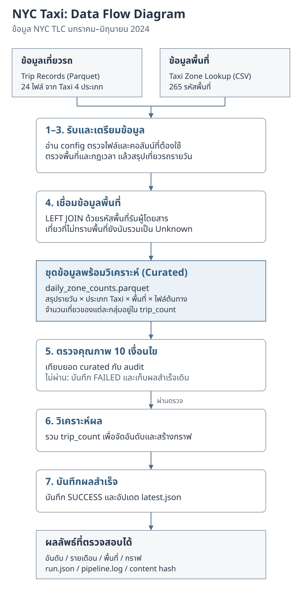

# CS341 Submission 2 — Reproducible NYC Taxi Data Pipeline

โปรเจกต์นี้พัฒนาต่อจาก [Notebook ของ Submission 1](6709650607_Submission_1_CS341.ipynb) ให้เป็นระบบเตรียมข้อมูลที่สั่งรัน ตรวจคุณภาพ และเก็บผลไว้ตรวจสอบย้อนหลังได้ โดยยังตอบคำถามเดิม:

> **Taxi ประเภทใดมีจำนวนเที่ยวมากที่สุดในช่วงครึ่งปีแรกของปี 2024?**
>
> Which taxi type was the most used in the first half of 2024?

ระบบใช้ Python และ DuckDB ประมวลผลข้อมูลเที่ยวรถ 4 ประเภท ช่วงมกราคม–มิถุนายน 2024 แล้วเชื่อมกับตารางพื้นที่ Taxi Zone เพื่อสร้าง **curated output หรือชุดข้อมูลที่จัดเตรียมและตรวจสอบแล้ว** ในรูปจำนวนเที่ยวรายวัน แยกประเภท Taxi และพื้นที่รับผู้โดยสาร

ในงานนี้ “ใช้งานมากที่สุด” หมายถึง **จำนวนระเบียนการเดินทางที่ผ่านกฎตรวจสอบ (valid trip records)** ส่วน baseline หมายถึงผลที่บันทึกไว้ใน Submission 1 ซึ่งนำมาใช้เทียบกับผลรอบใหม่

## องค์ประกอบที่ส่งใน Submission 2

Repository นี้รวบรวมไฟล์ที่ใช้รัน pipeline เอกสาร และผลจากการรันจริง เพื่อให้ผู้ตรวจเข้าใจโครงสร้าง ติดตั้งและรันระบบตามได้ รวมถึงตรวจสอบว่าผลวิเคราะห์มาจากข้อมูลและขั้นตอนใด ตารางนี้สรุปองค์ประกอบครบทั้ง 11 ข้อตามข้อกำหนด พร้อมตำแหน่งที่เปิดตรวจได้

| ลำดับ | องค์ประกอบที่กำหนด | เนื้อหาและไฟล์ที่ใช้ตรวจ |
|---|---|---|
| 1 | Source code / workflow ที่ใช้จริง | [คำสั่งเริ่มรัน](run_pipeline.py), [โค้ดแต่ละส่วนของ pipeline](taxi_pipeline/), [config](config/pipeline.json) และ [workflow ทดสอบบน GitHub Actions](.github/workflows/ci.yml) |
| 2 | README อธิบายข้อมูล โครงสร้าง pipeline วิธีติดตั้ง และวิธีรัน | อ่านหัวข้อ [ข้อมูลที่ใช้](#ข้อมูลและกฎที่ใช้), [ขั้นตอนของ pipeline](#pipeline-ทำอะไรบ้าง), [โครงสร้างโปรเจกต์](#โครงสร้างโปรเจกต์), [การติดตั้ง](#ติดตั้ง) และ [การรันข้อมูลจริง](#รัน-pipeline-กับข้อมูลจริง) ในหน้านี้ |
| 3 | Pipeline / Data Flow Diagram | มี [Data Flow Diagram ใน README](#data-flow-diagram), [ภาพ SVG](docs/images/pipeline-data-flow.svg) และ [ฉบับ Mermaid](docs/pipeline.mmd) แสดงข้อมูลที่ส่งระหว่างการรับข้อมูล ตรวจสอบ สรุป เชื่อมพื้นที่ และสร้างผลวิเคราะห์ |
| 4 | หลักฐานการรัน pipeline และสถานะการทำงาน | [สถานะและ log แต่ละรอบ](artifacts/runs/) มี `run.json`, `pipeline.log` และ `events.jsonl` ส่วน [reproducibility.json](artifacts/reproducibility.json) ระบุรอบคำนวณใหม่และรอบใช้ cache ที่ได้ผลตรงกัน |
| 5 | ตัวอย่างชุดข้อมูลพร้อมใช้สำหรับการวิเคราะห์ | [CSV ตัวอย่าง 200 แถว](artifacts/curated/sample_daily_zone_counts.csv), [curated Parquet ฉบับเต็ม 153,662 แถว](artifacts/curated/daily_zone_counts.parquet) และ [คำอธิบายคอลัมน์](docs/data_dictionary.md) |
| 6 | ผลของการตรวจสอบคุณภาพข้อมูล | [Quality report](artifacts/quality/quality.json) ผ่าน 10 ข้อ พร้อม [audit รายไฟล์](artifacts/quality/file_audit.csv) สำหรับตรวจยอดข้อมูลดิบ ข้อมูลที่ผ่านกฎ และข้อมูลที่คัดออก |
| 7 | ผลวิเคราะห์หรือ output ที่ตอบโจทย์หลัก | [ผลวิเคราะห์](artifacts/results/analysis.md), [ตารางอันดับ](artifacts/results/ranking.csv) และ [กราฟ](artifacts/results/taxi_usage.png) แสดงว่า High Volume FHV มีจำนวนเที่ยวที่ผ่านกฎมากที่สุดในครึ่งปีแรกของ 2024 |
| 8 | การตัดสินใจออกแบบอย่างน้อย 2 ข้อ พร้อมเหตุผล | มีเหตุผลของการตัดสินใจ 4 ข้อในหัวข้อ [การพัฒนาจาก Submission 1](#พัฒนาจาก-submission-1-อย่างไร) และคำอธิบายพร้อมข้อแลกเปลี่ยนใน [เอกสารการออกแบบ](docs/design.md) |
| 9 | สรุปการพัฒนาจาก Submission 1 และข้อจำกัดที่ยังมี | มี [ตารางเปรียบเทียบใน README](#พัฒนาจาก-submission-1-อย่างไร), [การเปรียบเทียบฉบับเต็ม](docs/baseline_comparison.md) และ [ข้อจำกัดปัจจุบัน](#ข้อจำกัดของ-pipeline-ปัจจุบัน) โดยผลจำนวนเที่ยวตรงกับ baseline ทั้ง 4 ประเภท |
| 10 | Learning Reflection เป็นย่อหน้าสั้น 3–5 ประโยค | มี [Reflection 1 ย่อหน้า 5 ประโยคใน README](#learning-reflection) และ [ไฟล์ Reflection](docs/reflection.md) ที่ระบุการใช้ AI ช่วยทำงานด้วย |
| 11 | ข้อจำกัดของ pipeline ปัจจุบัน | อ่าน [ข้อจำกัดใน README](#ข้อจำกัดของ-pipeline-ปัจจุบัน) และ [รายละเอียดเพิ่มเติม](docs/baseline_comparison.md#ข้อจำกัดที่ยังมี) ครอบคลุมข้อมูลสรุป พื้นที่ที่หายไป การตรวจคุณภาพ และการรันแบบ batch |

## ผลวิเคราะห์

**High Volume FHV มีจำนวนเที่ยวมากที่สุด: 120,864,668 เที่ยว หรือ 80.76% ของเที่ยวที่ผ่านกฎทั้งหมด**

| อันดับ | ประเภท Taxi | จำนวนเที่ยวที่ผ่านกฎ | สัดส่วน |
|---|---|---:|---:|
| 1 | High Volume FHV | 120,864,668 | 80.76% |
| 2 | Yellow | 20,331,754 | 13.59% |
| 3 | FHV | 8,119,228 | 5.43% |
| 4 | Green | 339,801 | 0.23% |

จากข้อมูลดิบ **149,655,796 ระเบียน** มีข้อมูลผ่านกฎ **149,655,451 ระเบียน** และถูกคัดออก **345 ระเบียน** ผลทั้ง 4 ประเภทตรงกับ baseline โดยมีส่วนต่างเป็น 0 ทุกประเภท ตรวจได้จาก [ตารางเปรียบเทียบ](artifacts/results/baseline_comparison.csv)


ชุดข้อมูลพร้อมใช้มี **153,662 แถว** แต่ละแถวเป็นยอดสรุปของหนึ่งกลุ่ม เมื่อต้องการหาจำนวนเที่ยวจึงต้องรวมค่า `trip_count` ดู [ผลวิเคราะห์ฉบับเต็ม](artifacts/results/analysis.md) และ [ตารางอันดับ](artifacts/results/ranking.csv)

## ติดตั้ง

ใช้ **Python 3.13** ซึ่งเป็นรุ่นที่ทดสอบกับโปรเจกต์นี้ และ Git หากต้องการรันข้อมูลดิบทั้งชุด ควรมีพื้นที่ว่างอย่างน้อย 8 GiB โดยไฟล์ข้อมูลดิบที่ใช้อยู่มีขนาดรวมประมาณ 3.12 GiB

```bash
git clone https://github.com/ronnakrit303/CS341-Submission2.git
cd CS341-Submission2
python -m venv .venv
```

**Windows PowerShell:** ติดตั้งและตรวจงานผ่าน Python ใน virtual environment ได้โดยตรง

```powershell
.\.venv\Scripts\python.exe -m pip install -r requirements-dev.txt
.\.venv\Scripts\python.exe -m pytest -v
.\.venv\Scripts\python.exe scripts/verify_artifacts.py
```

**Linux/macOS:** เปิดใช้ virtual environment ก่อนรันคำสั่ง

```bash
source .venv/bin/activate
python -m pip install -r requirements-dev.txt
python -m pytest -v
python scripts/verify_artifacts.py
```

ตัวอย่างส่วนถัดไปใช้คำสั่ง `python` ของ environment ที่ติดตั้ง dependencies แล้ว บน Windows หากยังไม่ได้เปิดใช้ `.venv` ให้แทน `python` ด้วย `.\.venv\Scripts\python.exe`

`requirements.txt` ระบุแพ็กเกจสำหรับรัน pipeline ส่วน `requirements-dev.txt` รวมแพ็กเกจเหล่านั้นและ pytest สำหรับทดสอบ

## ตรวจงานจากไฟล์ที่แนบใน repository

โฟลเดอร์ `artifacts/` มี [curated Parquet ฉบับเต็ม](artifacts/curated/daily_zone_counts.parquet), [ตัวอย่าง CSV 200 แถว](artifacts/curated/sample_daily_zone_counts.csv), ผลวิเคราะห์ และหลักฐานการรันจริง จึงตรวจส่วนนี้ได้โดยไม่ต้องดาวน์โหลดข้อมูลดิบ

```bash
python -m pytest -v
python scripts/verify_artifacts.py
```

| คำสั่ง | สิ่งที่ตรวจ | ผลที่คาดหวังในรุ่นปัจจุบัน |
|---|---|---|
| `python -m pytest -v` | พฤติกรรมของ pipeline ด้วยข้อมูลทดสอบขนาดเล็ก | บน Windows: `31 passed` |
| `python scripts/verify_artifacts.py` | ไฟล์หลักฐานและความสอดคล้องของผลลัพธ์จริงที่แนบไว้ | `PASS` |

Tests ครอบคลุมโครงสร้างคอลัมน์ กฎคัดกรอง การเชื่อมพื้นที่ การใช้ cache การเพิ่มเดือน การเปลี่ยนข้อมูลต้นทาง และการหยุดเมื่อข้อมูลผิด รวมถึงการรักษาผลสำเร็จเดิมเมื่อรอบใหม่ล้มเหลว ดู [tests ของ pipeline](tests/test_pipeline.py) และ [tests การล็อกไฟล์](tests/test_atomic_files.py) โดยมีหนึ่ง test สำหรับการล็อกไฟล์จริงบน Windows ซึ่งจะถูกข้ามเมื่อรันบนระบบอื่น

ตัวตรวจหลักฐานจะเช็กขนาดและค่าแฮช SHA-256 เพื่อดูว่าเนื้อหาไฟล์ตรงกับที่บันทึกไว้ จากนั้นรวมยอดจาก curated data ใหม่เพื่อเทียบกับตารางอันดับและรายงานตรวจข้อมูลรายไฟล์ (audit) พร้อมตรวจหลักฐานการรันซ้ำ ชุดหลักฐานที่แนบอยู่ในปัจจุบันให้ผล:

```text
PASS: 47 artifact hashes; 24 source audits; 149,655,451 valid trip records; unchanged rerun verified
```

หากต้องการทดสอบเฉพาะการอัปเดตข้อมูลและการจัดการข้อผิดพลาด ใช้:

```bash
python -m pytest -v -k "added_month or refresh_changed or failed_refresh or all_invalid or publish_failure"
```

ผลที่คาดหวังคือ `7 passed, 24 deselected` โดย 24 เคสที่เหลือไม่ได้ถูกเลือกมารัน คำสั่งทดสอบใช้ไฟล์ขนาดเล็กใน `tmp/pytest-runs/` แยกจากข้อมูลจริง บางเคสตั้งใจทำให้ pipeline หยุด และถือว่าผ่านเมื่อระบบตรวจพบปัญหาได้ถูกต้อง

GitHub Actions รัน tests และตัวตรวจหลักฐานให้อัตโนมัติ ดู [สถานะการทดสอบบน GitHub](https://github.com/ronnakrit303/CS341-Submission2/actions) โดย workflow ใช้ข้อมูลทดสอบขนาดเล็กและไฟล์ใน `artifacts/` ส่วนหลักฐานการประมวลผลข้อมูลดิบทั้งชุดเก็บแยกไว้ใน [ประวัติการรัน](artifacts/runs/)

## รัน pipeline กับข้อมูลจริง

### รันครั้งแรก

```bash
python run_pipeline.py
```

ระบบจะอ่าน [ไฟล์ตั้งค่า (config)](config/pipeline.json) ดาวน์โหลดไฟล์ที่ยังไม่มีในเครื่อง ตรวจข้อมูล สร้าง curated output และสร้างผลวิเคราะห์ ค่าเริ่มต้นคือ Taxi 4 ประเภท × 6 เดือน รวม 24 ไฟล์ Parquet และตารางพื้นที่อีก 1 ไฟล์ CSV

### ตรวจว่ารันซ้ำแล้วได้ผลเดิม

เมื่อมีข้อมูลดิบในเครื่องแล้ว ให้รันสองคำสั่งนี้ตามลำดับ:

```bash
python run_pipeline.py --offline --rebuild
python run_pipeline.py --offline
```

`--offline` ใช้ข้อมูลดิบที่เก็บไว้ในเครื่อง โดยตรวจค่าแฮชก่อนใช้และไม่ส่งคำขอผ่าน HTTP ส่วน `--rebuild` สั่งให้คำนวณผลสรุปใหม่แทนการใช้ cache ซึ่งเป็นผลคำนวณที่เก็บไว้จากรอบก่อน

| สิ่งที่ตรวจ | รอบ `--offline --rebuild` | รอบ `--offline` |
|---|---|---|
| สถานะ | SUCCESS ครบ 7/7 ขั้นตอน | SUCCESS ครบ 7/7 ขั้นตอน |
| การคำนวณข้อมูลเที่ยวรถ | `processed=24`, `reused=0` | `processed=0`, `reused=24` |
| จำนวนเที่ยวที่ผ่านกฎ | 149,655,451 | 149,655,451 |
| จำนวนแถวใน curated | 153,662 | 153,662 |
| Run ID | รหัสของรอบแรก | รหัสใหม่ของรอบที่สอง |

เปิด `reports/runs/<run_id>/run.json` ของทั้งสองรอบ แล้วเทียบ `curated_content_sha256` ซึ่งเป็นค่าแฮชของเนื้อหา curated ที่เรียงลำดับแน่นอน ค่าที่เท่ากันยืนยันว่าเนื้อหาผลลัพธ์เหมือนเดิม หลักฐานที่แนบใน repository ระบุสองรอบนี้ไว้ใน [reproducibility.json](artifacts/reproducibility.json)

### อัปเดตข้อมูลหรือเปลี่ยนช่วงเวลา

```bash
# ดาวน์โหลดไฟล์ที่ร้องขอใหม่ทั้งหมด เพื่อตรวจข้อมูลต้นทางที่อาจมีการแก้ไข
python run_pipeline.py --refresh

# ตัวอย่างเพิ่มเดือนกรกฎาคม 2024
python run_pipeline.py --start-month 2024-01 --end-month 2024-07
```

การรันปกติจะใช้ข้อมูลเดิมที่ตรวจค่าแฮชผ่าน และดาวน์โหลดไฟล์ที่ยังไม่มีหรือใช้ไม่ได้ หากต้องการตรวจว่าไฟล์บนต้นทางเปลี่ยนไปหรือไม่ ให้สั่ง `--refresh` โดยใช้ร่วมกับ `--offline` ไม่ได้

เมื่อเพิ่มเดือน ช่วงวันที่ที่ใช้ตรวจข้อมูลจะเปลี่ยน ระบบจึงคำนวณไฟล์เดิมใหม่ด้วย และรับไฟล์เดือนใหม่เพิ่ม ผลของช่วงอื่นจะระบุช่วงเวลานั้นอย่างชัดเจน ส่วนคำตอบหลักของงานนี้ยังอ้างอิงมกราคม–มิถุนายน 2024 ตั้งค่าเดือน ตำแหน่งไฟล์ และทรัพยากรที่ใช้ได้ใน [config/pipeline.json](config/pipeline.json)

## Pipeline ทำอะไรบ้าง

ระบบแบ่งการทำงานเป็น **7 ขั้นตอน** ตามลำดับ:

| ขั้น | ชื่อใน log | การทำงาน |
|---|---|---|
| 1/7 | PREPARE | เตรียมระบบ รายการไฟล์ และโฟลเดอร์ของรอบนี้ |
| 2/7 | LOOKUP | รับหรือตรวจ CSV ของพื้นที่ ตรวจคอลัมน์และรหัสพื้นที่ที่ไม่ซ้ำ |
| 3/7 | TRIPS | ตรวจหรือดาวน์โหลด Parquet แต่ละไฟล์ แล้วคำนวณหรือใช้ผลสรุปจาก cache |
| 4/7 | CURATED | รวมผลสรุป เชื่อมชื่อพื้นที่ และเขียนชุดข้อมูลพร้อมใช้ |
| 5/7 | QUALITY | ตรวจคุณภาพและเทียบยอดข้อมูล พร้อมแสดงข้อควรทราบ |
| 6/7 | ANALYSIS | สร้างอันดับ ตารางรายเดือน ตารางพื้นที่ กราฟ และตัวอย่าง CSV |
| 7/7 | PUBLISH | บันทึกสถานะสำเร็จและตำแหน่งผลลัพธ์ล่าสุดในเครื่อง |

### Data Flow Diagram

แผนภาพนี้แสดงว่าข้อมูลเที่ยวรถและตารางพื้นที่ไหลมารวมกันอย่างไร ก่อนตรวจคุณภาพ สร้างผลวิเคราะห์ และบันทึกผลสำเร็จ หมายเลข **1–7** ตรงกับขั้นตอนใน log โดยระบบรันตามลำดับในตารางด้านบน ส่วนลูกศรในภาพระบุข้อมูลที่ส่งต่อระหว่างส่วน



[เปิดภาพขนาดเต็ม](docs/images/pipeline-data-flow.svg) · [เปิดฉบับ Mermaid](docs/pipeline.mmd)

- **กล่องกระบวนการสีน้ำเงิน:** ขั้นตอน 1–7 พร้อมชื่อและคำอธิบายการทำงาน
- **กรอบสีเทา:** ข้อมูลต้นทางและไฟล์ตั้งค่า ส่วนข้อมูลที่เก็บไว้ใช้สัญลักษณ์เปิดด้านขวาและรหัส D1–D5 กำกับ
- **เส้นประ:** กรณีตรวจไม่ผ่าน ส่วนข้อผิดพลาดในขั้นอื่นใช้หลักเดียวกัน คือบันทึก FAILED และเก็บผลสำเร็จเดิมไว้

ลูกศรจาก D2 กลับไป TRIPS แสดงการใช้ cache เมื่อข้อมูลและเงื่อนไขตรงกัน ส่วนเส้น audit จาก D2 ไป QUALITY ใช้เทียบยอด `raw / valid / rejected` กับจำนวนเที่ยวใน curated การส่งออกหลักฐานไปยัง GitHub ทำแยกหลัง pipeline สำเร็จ

หากต้องการแก้ข้อความ สี หรือตำแหน่งกล่อง ให้แก้ [สคริปต์สร้างแผนภาพ](scripts/render_pipeline_diagram.py) แล้วรันคำสั่งนี้เพื่อสร้าง SVG และ Mermaid จากข้อมูลชุดเดียวกัน โดยใช้ Python มาตรฐาน:

```bash
python scripts/render_pipeline_diagram.py
```

### อ่านสถานะจาก log

ข้อความใน Terminal ช่วยติดตามการทำงาน และถูกบันทึกไว้ใน `pipeline.log` ของแต่ละรอบด้วย ก่อนเริ่มจะเห็น Run ID ช่วงข้อมูล โหมดที่ใช้ และรายชื่อทั้ง 7 ขั้นตอน จากนั้นมีลูกศรลง `↓` เชื่อมแต่ละขั้นให้อ่านจากบนลงล่าง

- `[STEP 03/07]` คือขั้นที่ 3 จากทั้งหมด 7 ขั้น
- `[FILE 05/24]` คือไฟล์ที่ 5 จากทั้งหมด 24 ไฟล์ ภายในขั้น TRIPS
- `RUNNING` คือกำลังทำงาน และ `OK` คือขั้นนั้นสำเร็จแล้ว
- `PROCESSED` คือคำนวณข้อมูลไฟล์นั้นใหม่ ส่วน `REUSED` คือใช้ผลคำนวณเดิมที่ข้อมูลและเงื่อนไขยังตรงกัน
- `WARN` คือข้อควรทราบ เช่น พื้นที่ของ FHV หายไป โดยข้อมูลเหล่านี้ยังถูกนับในยอดรวม
- `FAILED` คือรอบนี้ล้มเหลว ส่วนขั้นที่ยังไม่ได้ทำจะแสดง `SKIPPED`

ท้าย log มีสรุปสถานะ เวลา จำนวนข้อมูล และตำแหน่งผลลัพธ์ `Status: SUCCESS` หมายถึงรันสำเร็จและโปรแกรมจบด้วย exit code 0 ส่วน `Status: FAILED` จบด้วย exit code 1 ขั้น PUBLISH บันทึกผลไว้ในเครื่อง ส่วนการส่งออกหลักฐานและนำขึ้น GitHub ทำแยกภายหลัง

ดูตัวอย่างที่แนบไว้ได้จาก [log รอบคำนวณใหม่](artifacts/runs/20261115T003121Z-ad4d1e72/pipeline.log) และ [log รอบใช้ cache](artifacts/runs/20261115T003150Z-bb92cece/pipeline.log) เวลาในหลักฐานการรันเป็น UTC ซึ่งช้ากว่าเวลาไทย 7 ชั่วโมง

หาก Windows ล็อกไฟล์ชั่วคราวระหว่างแทนที่ไฟล์ ระบบจะลองซ้ำแบบจำกัดจำนวน หากยังทำไม่ได้จะรายงาน FAILED และคงตำแหน่งผลสำเร็จเดิมไว้ พฤติกรรมทั้งกรณีล็อกชั่วคราวและกรณีที่ต้องหยุดมี tests รองรับ

## ข้อมูลและกฎที่ใช้

ข้อมูลมาจาก [NYC TLC Trip Record Data](https://www.nyc.gov/site/tlc/about/tlc-trip-record-data.page) โดยใช้ **ข้อมูลสองชุดที่มีรูปแบบต่างกัน และเผยแพร่โดย NYC TLC เหมือนกัน**:

| ชุดข้อมูล | รูปแบบ | ใช้ทำอะไร |
|---|---|---|
| Trip Records: Yellow, Green, FHV และ High Volume FHV | Parquet จำนวน 24 ไฟล์ | ตรวจเวลาและนับเที่ยว แยกวัน ประเภท และรหัสพื้นที่รับผู้โดยสาร |
| Taxi Zone Lookup | CSV จำนวน 1 ไฟล์ | เพิ่มชื่อพื้นที่ Borough และ Service Zone จากรหัสพื้นที่ |

URL ของข้อมูลเที่ยวรถมีรูปแบบ `https://d37ci6vzurychx.cloudfront.net/trip-data/{prefix}_tripdata_{YYYY-MM}.parquet` โดย `{prefix}` คือ `yellow`, `green`, `fhv` หรือ `fhvhv` ส่วนตารางพื้นที่ใช้ [Taxi Zone Lookup CSV](https://d37ci6vzurychx.cloudfront.net/misc/taxi_zone_lookup.csv)

รายละเอียดไฟล์ที่ใช้จริงอยู่ใน [source manifest](artifacts/provenance/manifest.json) ซึ่งบันทึก URL ขนาดไฟล์ SHA-256 และเวลาที่รับข้อมูลไว้ครบทั้ง 25 ไฟล์ อ่านความหมายคอลัมน์ต้นทางได้จากเอกสาร TLC: [Yellow](https://www.nyc.gov/assets/tlc/downloads/pdf/data_dictionary_trip_records_yellow.pdf), [Green](https://www.nyc.gov/assets/tlc/downloads/pdf/data_dictionary_trip_records_green.pdf), [FHV](https://www.nyc.gov/assets/tlc/downloads/pdf/data_dictionary_trip_records_fhv.pdf) และ [High Volume FHV](https://www.nyc.gov/assets/tlc/downloads/pdf/data_dictionary_trip_records_hvfhs.pdf)

### กฎคัดกรองและการตรวจคุณภาพ

ใช้กฎเดียวกับ Submission 1 และคัดออกตามเหตุผลแรกที่พบ เพื่อไม่ให้นับระเบียนเดียวซ้ำหลายเหตุผล:

1. เวลาเริ่มเที่ยวไม่มีค่าหรือแปลงเป็นเวลาไม่ได้
2. เวลาจบเที่ยวไม่มีค่าหรือแปลงเป็นเวลาไม่ได้
3. เวลาเริ่มเที่ยวอยู่นอกช่วงวิเคราะห์
4. เวลาจบเที่ยวอยู่ก่อนเวลาเริ่มเที่ยว

ระยะทางศูนย์ ค่าโดยสารติดลบ จำนวนผู้โดยสารที่หายไป และรายการที่อาจซ้ำ ถูกบันทึกเป็นข้อมูลประกอบการตรวจสอบ โดยไม่ได้ใช้คัดออก การตรวจรายการที่อาจซ้ำทำกับ 10,000 แถวแรกของแต่ละไฟล์ และยังไม่ได้ยืนยันหรือลบเที่ยวซ้ำทั้งชุด

ก่อนเชื่อมพื้นที่ ระบบตรวจว่ารหัสพื้นที่ใน lookup ไม่ซ้ำ แล้วใช้ `LEFT JOIN` เพื่อเก็บเที่ยวที่ไม่มีพื้นที่ไว้ด้วย จากนั้นตรวจคุณภาพ 10 ข้อ ครอบคลุมความครบถ้วนของไฟล์และคอลัมน์ การแจกแจงยอดคัดออก สมการ `raw = valid + rejected` ยอดรวมของ curated จำนวนเที่ยวก่อนและหลัง join กลุ่มสรุปที่ไม่ซ้ำ จำนวนเที่ยวที่เป็นบวก และวันที่ในช่วงที่กำหนด

ผลจริงผ่านทั้ง 10 ข้อ อ่าน [quality report](artifacts/quality/quality.json) และ [audit รายไฟล์](artifacts/quality/file_audit.csv) ได้โดยตรง รายละเอียดกฎและคอลัมน์อยู่ใน [data dictionary](docs/data_dictionary.md)

## เปิดใช้ผลลัพธ์และตรวจสอบที่มา

Curated output สรุปข้อมูลตาม **วันที่รับผู้โดยสาร × ประเภท Taxi × รหัสพื้นที่รับผู้โดยสาร × ไฟล์ต้นทาง** พร้อมชื่อพื้นที่และจำนวนเที่ยวใน `trip_count` การเก็บชื่อไฟล์ต้นทางช่วยให้ย้อนกลับไปเทียบกับ audit ได้

ตัวอย่างอ่านชุดข้อมูลฉบับเต็มและรวมจำนวนเที่ยวด้วย Python:

```python
import duckdb

with duckdb.connect() as con:
    result = con.execute("""
        SELECT taxi_type, SUM(trip_count) AS valid_records
        FROM read_parquet('artifacts/curated/daily_zone_counts.parquet')
        GROUP BY taxi_type
        ORDER BY valid_records DESC
    """).fetchall()
    print(result)
```

ไฟล์ CSV 200 แถวเป็นตัวอย่างสำหรับดูรูปแบบข้อมูล ส่วนคำตอบของโจทย์คำนวณจาก Parquet ฉบับเต็ม

| ตำแหน่ง | สิ่งที่เก็บ |
|---|---|
| `artifacts/curated/` | Curated Parquet ฉบับเต็มและตัวอย่าง CSV ที่แนบใน repository |
| `artifacts/results/` | อันดับ ผลรายเดือน ผลตามพื้นที่ กราฟ และการเทียบ baseline |
| `artifacts/quality/` | ผลตรวจคุณภาพและ audit ของข้อมูลต้นทาง |
| `artifacts/provenance/` | รายการแหล่งข้อมูล ค่าแฮช และ config ที่ใช้ |
| `artifacts/runs/` | สถานะและ log ของรอบที่ส่งออกไว้เป็นหลักฐาน |
| `data/curated/<run_id>/` | Curated output ของแต่ละรอบที่รันในเครื่อง |
| `reports/runs/<run_id>/` | รายงาน audit, quality, analysis และ log ของแต่ละรอบในเครื่อง |
| `reports/latest.json` | ตำแหน่งผลลัพธ์ของรอบล่าสุดที่สำเร็จในเครื่อง |

`run.json` บันทึก config รุ่นแพ็กเกจ ค่าแฮชของโค้ด สถานะรายขั้น และผลสรุป ส่วน `events.jsonl` เก็บเหตุการณ์พร้อมเวลาในรูปแบบที่อ่านด้วยโปรแกรมได้ เมื่อรอบใหม่ล้มเหลว `reports/latest.json` จะยังชี้ไปยังผลสำเร็จก่อนหน้า

ข้อมูลดิบใน `data/raw/`, cache ใน `data/cache/` และผลรันในเครื่องถูกตั้งให้ Git ข้ามไว้ ชุดที่ผู้ตรวจเปิดจาก GitHub จึงอยู่ใน `artifacts/` ซึ่งแยกจากผลรันล่าสุดในเครื่อง

หลังรันสองรอบสำเร็จและได้ผลเดิม หากต้องการส่งออกหลักฐานรอบใหม่ไปยัง `artifacts/` ใช้:

```bash
python scripts/export_evidence.py
python scripts/verify_artifacts.py
```

สคริปต์ export ตรวจว่ามีสองรอบที่สำเร็จด้วย config และโค้ดเดียวกัน ได้ยอดกับเนื้อหา curated ตรงกัน และรอบล่าสุดใช้ cache ครบทุกไฟล์ จากนั้นคัดลอกหลักฐานไปยัง `artifacts/` ในเครื่อง หากต้องการให้หลักฐานใหม่ปรากฏบน GitHub ต้อง commit และ push ไฟล์เหล่านี้ด้วย ดูรายละเอียดเพิ่มเติมใน [คู่มือไฟล์หลักฐาน](artifacts/README.md)

## โครงสร้างโปรเจกต์

```text
run_pipeline.py                จุดเริ่มต้นสำหรับสั่งรัน pipeline
config/pipeline.json            ช่วงเดือน แหล่งข้อมูล และการใช้ทรัพยากร
taxi_pipeline/                 โค้ดรับข้อมูล ตรวจสอบ สรุป เชื่อม และสร้างรายงาน
baseline/expected_counts.json   ผล Submission 1 สำหรับเปรียบเทียบ
tests/                         ชุดทดสอบด้วยข้อมูลขนาดเล็ก
conftest.py                    แยกโฟลเดอร์ชั่วคราวของการทดสอบแต่ละรอบ
.github/workflows/ci.yml        ทดสอบอัตโนมัติบน GitHub Actions
scripts/                       สคริปต์ส่งออกและตรวจหลักฐาน
docs/                          แผนภาพ พจนานุกรมข้อมูล การออกแบบ และ Reflection
artifacts/                     ชุดข้อมูล ผลวิเคราะห์ และหลักฐานที่ส่งตรวจ
data/                          ข้อมูลดิบ cache และ curated ที่สร้างในเครื่อง
reports/                       สถานะและผลรันที่สร้างในเครื่อง
```

Notebook เดิม `6709650607_Submission_1_CS341.ipynb` เก็บไว้ที่โฟลเดอร์หลักเพื่อใช้อ้างอิง Submission 1

## พัฒนาจาก Submission 1 อย่างไร

| ส่วนงาน | Submission 1 | Submission 2 |
|---|---|---|
| วิธีรัน | Notebook ที่ทำงานตาม cell | CLI และ config สำหรับสั่งรันตามช่วงข้อมูล |
| ข้อมูล | ข้อมูลเที่ยวรถ Parquet | เพิ่ม CSV ของพื้นที่และเชื่อมใช้งานจริง |
| ผลที่จัดเก็บ | ผลสรุปใน Notebook | Curated Parquet, CSV ตัวอย่าง และรายงานแยกไฟล์ |
| การรันซ้ำ | คำนวณ audit ใหม่ใน Notebook | ตรวจค่าแฮชและใช้ cache ตามข้อมูลกับเงื่อนไขที่ตรงกัน |
| การตรวจงาน | อ่านผลจาก cell | มี quality report, log รายขั้น, tests และหลักฐานแต่ละรอบ |

แม้รูปแบบระบบเปลี่ยนไป แต่ยังใช้กฎคัดกรองและตัวชี้วัดเดิม จึงเทียบคำตอบกับ Submission 1 ได้ตรง ดู [การเปรียบเทียบฉบับเต็ม](docs/baseline_comparison.md)

การตัดสินใจหลักในการออกแบบ ได้แก่:

1. **ใช้ DuckDB และเก็บผลสรุปรายวัน** เพื่อประมวลผลข้อมูลขนาดใหญ่และเก็บ output ใน GitHub ได้สะดวก โดยนำทุกเที่ยวที่ผ่านกฎมาคำนวณ
2. **คงกฎและตัวชี้วัดเดิม** เพื่อให้ผลเปรียบเทียบกับ Submission 1 มีความหมาย
3. **ใช้ LEFT JOIN และเก็บพื้นที่ Unknown** เพื่อให้การเพิ่มชื่อพื้นที่ไม่ทำให้ยอดเที่ยวลดลง
4. **แยกผลรันแต่ละรอบและอัปเดตตำแหน่งล่าสุดเมื่อสำเร็จ** เพื่อให้รอบที่ล้มเหลวไม่แทนผลที่ใช้งานได้

อ่านเหตุผลและข้อแลกเปลี่ยน รวมถึงวิธีออกแบบ cache ได้ใน [เอกสารการออกแบบ](docs/design.md)

## ข้อจำกัดของ pipeline ปัจจุบัน

- Curated เป็นข้อมูลสรุป จึงใช้วิเคราะห์การกระจายค่าโดยสารหรือระยะเวลารายเที่ยวต่อไม่ได้
- FHV มี 6,359,783 เที่ยวที่ไม่มีรหัสพื้นที่รับผู้โดยสารที่ใช้ได้ ระบบยังนับเที่ยวเหล่านี้ไว้ในกลุ่ม Unknown ทำให้การวิเคราะห์แยกพื้นที่ของ FHV มีข้อจำกัด
- กฎตรวจคุณภาพครอบคลุมเงื่อนไขที่กำหนดไว้ ความถูกต้องส่วนอื่นยังขึ้นกับข้อมูลต้นทาง และยังไม่ได้ยืนยันหรือลบรายการซ้ำทั้งชุด
- ตัวชี้วัดนับระเบียนการเดินทาง จึงใช้สรุปจำนวนผู้โดยสารไม่ซ้ำ รายได้ หรือสาเหตุของความนิยมโดยตรงไม่ได้
- ระบบทำงานเป็น batch บนเครื่องเดียว ต้องสั่งรันเอง และตรวจการแก้ไขไฟล์บนต้นทางเมื่อใช้ `--refresh`

อ่าน [ข้อจำกัดเพิ่มเติม](docs/baseline_comparison.md#ข้อจำกัดที่ยังมี) ได้ในเอกสารเปรียบเทียบกับ Submission 1

## Learning Reflection

การพัฒนางานจาก Submission 1 มาเป็น pipeline ทำให้ผมเห็นว่าต้องเก็บทั้งผลวิเคราะห์และหลักฐานว่าผลนั้นมาจากข้อมูลและขั้นตอนใด เมื่อทดลองรัน `--offline --rebuild` แล้วตามด้วย `--offline` ผมพบว่ารอบแรกคำนวณใหม่ครบ 24 ไฟล์ ส่วนรอบถัดไปใช้ cache ได้ครบและยังได้จำนวนเที่ยวกับค่าแฮชของผลลัพธ์เท่าเดิม การขอปรับ log ให้แสดงครบ 7 ขั้นตอน มีสถานะและลูกศรลง ช่วยให้ผมติดตามได้ว่าระบบกำลังทำอะไรและหยุดอยู่ตรงไหน การพบ PermissionError ระหว่างทดสอบทำให้ผมเห็นว่าต้องแยกปัญหาการเข้าถึงไฟล์ออกจากปัญหาคุณภาพข้อมูล และตรวจสถานะของแต่ละรอบก่อนสรุปว่ารันสำเร็จ ผมยังได้เห็นข้อจำกัดของข้อมูลสรุปรายวันและข้อมูลพื้นที่ที่หายไปใน FHV จึงต้องอธิบายขอบเขตของผลวิเคราะห์ควบคู่กับคำตอบที่ได้

ย่อหน้านี้ตรงกับ [ไฟล์ Learning Reflection](docs/reflection.md) ซึ่งมีรายละเอียดการใช้ AI ช่วยทำงานเพิ่มเติม

## หลักฐานตาม rubric

| เกณฑ์ | คะแนน | หลักฐานหลัก |
|---|---:|---|
| เตรียม จัดการ และจัดเก็บข้อมูล | 20 | [โค้ดรับข้อมูล](taxi_pipeline/download.py), [โค้ดเตรียมข้อมูล](taxi_pipeline/transform.py), [source manifest](artifacts/provenance/manifest.json) |
| เชื่อมข้อมูลและสร้าง curated output | 20 | [config](config/pipeline.json), [curated Parquet](artifacts/curated/daily_zone_counts.parquet), [data dictionary](docs/data_dictionary.md) |
| รันซ้ำหรืออัปเดตข้อมูลใหม่ | 15 | [โค้ดควบคุม pipeline](taxi_pipeline/pipeline.py), [หลักฐานสองรอบ](artifacts/reproducibility.json), [tests](tests/test_pipeline.py) |
| ตรวจคุณภาพและแสดงสถานะ | 15 | [quality report](artifacts/quality/quality.json), [audit](artifacts/quality/file_audit.csv), [log การรันจริง](artifacts/runs/) |
| บูรณาการเพื่อสร้างตัวชี้วัด | 15 | [โค้ดสร้างรายงาน](taxi_pipeline/report.py), [อันดับ](artifacts/results/ranking.csv), [ผลรายเดือน](artifacts/results/monthly_counts.csv) |
| นำเสนอและตรวจสอบย้อนกลับ | 15 | [ผลวิเคราะห์](artifacts/results/analysis.md), [Data Flow Diagram](docs/images/pipeline-data-flow.svg), [การออกแบบ](docs/design.md), [การเทียบ baseline](docs/baseline_comparison.md), [ตัวตรวจหลักฐาน](scripts/verify_artifacts.py) |

ส่งลิงก์ repository ผ่าน [แบบฟอร์ม Submission 2](https://forms.gle/9cTHMWrAKyXsm8Ud7) ตามขั้นตอนของรายวิชา
