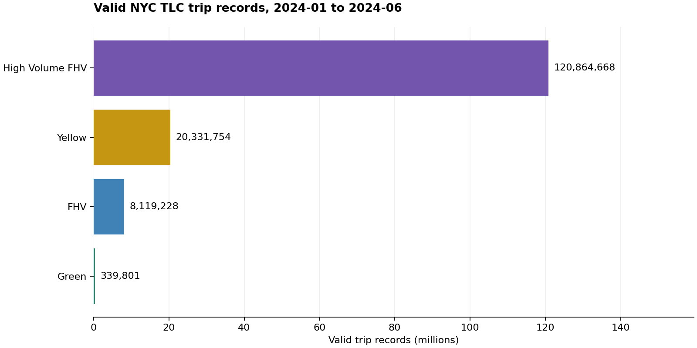
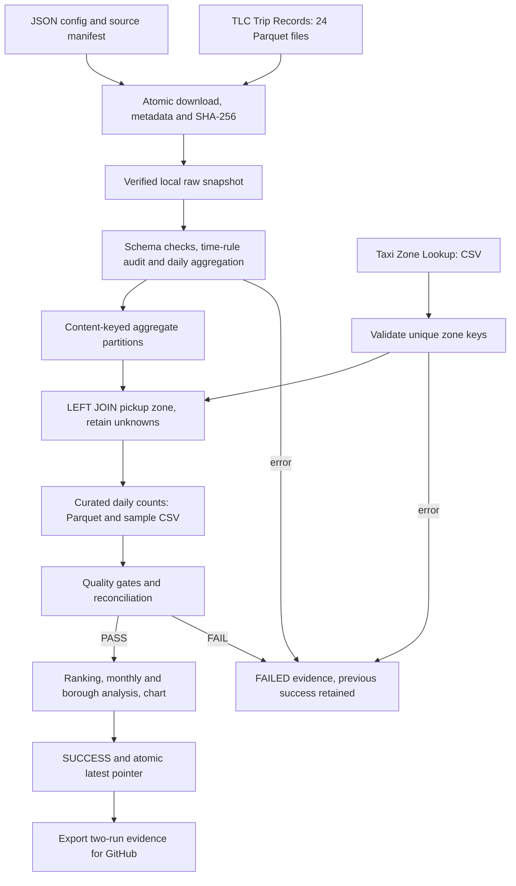

# CS341 Submission 2 — Reproducible NYC Taxi Data Pipeline

พัฒนาต่อจาก [`6709650607_Submission_1_CS341.ipynb`](6709650607_Submission_1_CS341.ipynb) ให้เป็น batch data pipeline ที่ติดตั้ง รันซ้ำ ตรวจคุณภาพ และตรวจย้อนกลับได้ โดยยังตอบคำถามเดิม:

> **Which taxi type was the most used in the first half of 2024?**

นิยาม **most used = จำนวน valid trip records** ครอบคลุม Yellow, Green, FHV และ High Volume FHV ช่วง 1 มกราคม–30 มิถุนายน 2024 ใช้ Python + DuckDB อ่านข้อมูลดิบ 24 ไฟล์ Parquet และเชื่อมกับ Taxi Zone Lookup CSV เพื่อสร้าง curated daily pickup-zone counts ข้อมูลสองชุดมี publisher เดียวกันคือ NYC TLC แต่เป็นคนละ dataset/รูปแบบและมีการ join ใช้ประโยชน์จริง

## ผลจากการรันจริง

| อันดับ | Taxi type | Valid trip records | สัดส่วน |
|---|---|---:|---:|
| 1 | **High Volume FHV** | **120,864,668** | **80.76%** |
| 2 | Yellow | 20,331,754 | 13.59% |
| 3 | FHV | 8,119,228 | 5.43% |
| 4 | Green | 339,801 | 0.23% |

ประมวลผล **149,655,796 raw records → 149,655,451 valid records + 345 rejected records** ผ่าน quality gates ทั้ง 10 ข้อ Curated dataset เต็มมี **153,662 แถว** และ **364,118 bytes** ผลทั้งสี่ประเภทตรงกับ saved outputs ของ baseline และผู้ชนะไม่เปลี่ยนเมื่อเทียบ raw กับ valid counts ผลนี้วัดจำนวนระเบียนการเดินทาง ไม่ใช่จำนวนผู้โดยสารไม่ซ้ำ รายได้ หรือสาเหตุของความนิยม



ตรวจหลักฐานได้ที่ [ผลวิเคราะห์](artifacts/results/analysis.md), [ranking.csv](artifacts/results/ranking.csv), [quality.json](artifacts/quality/quality.json), [file-level audit](artifacts/quality/file_audit.csv) และ [การเทียบ baseline](artifacts/results/baseline_comparison.csv)

## เริ่มตรวจงานได้โดยไม่ดาวน์โหลด raw data

Repository มี [curated Parquet เต็ม](artifacts/curated/daily_zone_counts.parquet), [ตัวอย่าง CSV 200 แถว](artifacts/curated/sample_daily_zone_counts.csv), ผลวิเคราะห์ และหลักฐานจาก **full run + unchanged rerun จริง** อยู่แล้ว ตัวอย่าง CSV เป็นเพียงตัวอย่างของ dataset; คำตอบคำนวณจาก Parquet เต็ม

หลังติดตั้ง dependencies ให้รัน:

```bash
python scripts/verify_artifacts.py
```

คำสั่งนี้ไม่ใช้ HTTP ตรวจ SHA-256/ขนาดไฟล์หลักฐานทั้งหมด แล้วใช้ DuckDB รวม curated counts ใหม่เพื่อเทียบกับ ranking และ audit พร้อมตรวจ canonical content hash และหลักฐานการรันซ้ำ ดูรายละเอียดที่ [artifacts/README.md](artifacts/README.md)

## ติดตั้ง

ใช้ **Python 3.13** ซึ่งเป็นรุ่นที่ทดสอบจริง และ Git แนะนำพื้นที่ว่างอย่างน้อย 8 GiB หากต้องการรัน full pipeline ครั้งแรก ข้อมูล raw ที่ดาวน์โหลดจริงมีขนาดรวมประมาณ **3.12 GiB**; ไม่เก็บ raw data และ cache ใน Git

```bash
git clone https://github.com/ronnakrit303/CS341-Submission2.git
cd CS341-Submission2
python -m venv .venv
```

Windows PowerShell ใช้ Python ใน virtual environment โดยตรงได้:

```powershell
.\.venv\Scripts\python.exe -m pip install -r requirements-dev.txt
.\.venv\Scripts\python.exe scripts/verify_artifacts.py
.\.venv\Scripts\python.exe run_pipeline.py
.\.venv\Scripts\python.exe -m pytest -q
```

Linux/macOS:

```bash
source .venv/bin/activate
python -m pip install -r requirements-dev.txt
python scripts/verify_artifacts.py
python run_pipeline.py
python -m pytest -q
```

`requirements.txt` มี runtime dependencies; `requirements-dev.txt` เพิ่ม pytest โค้ดไม่สั่งติดตั้งแพ็กเกจหรือเปลี่ยน environment ให้อัตโนมัติระหว่างรัน

## รันซ้ำ อัปเดต และเลือก snapshot

ตัวอย่างด้านล่างใช้ `python`; บน Windows ที่ไม่ได้ activate environment ให้แทนด้วย `.\.venv\Scripts\python.exe`

```bash
# Full H1 2024 run; config เริ่มต้นมีครบ 4 ประเภท × 6 เดือน
python run_pipeline.py --config config/pipeline.json

# Rerun จาก raw snapshot ที่ hash ตรง ไม่ส่ง HTTP request
python run_pipeline.py --offline

# คำนวณใหม่จาก snapshot เดิมโดยไม่ใช้ aggregate cache
python run_pipeline.py --offline --rebuild

# ดาวน์โหลด inputs ใหม่เพื่อตรวจ upstream revisions และ rebuild เฉพาะที่ cache ใช้ไม่ได้
python run_pipeline.py --refresh

# ตัวอย่างขยายช่วงเวลา: กรกฎาคม 2024 (คำสั่งตัวอย่าง ไม่ใช่หลักฐาน H1 ที่ส่ง)
python run_pipeline.py --start-month 2024-01 --end-month 2024-07
```

ช่วงเดือนรวมทั้งเดือนเริ่มต้นและสิ้นสุด ตั้งค่า source mappings, path, threads และ memory limit ได้ใน [`config/pipeline.json`](config/pipeline.json) `--offline` ใช้ร่วมกับ `--refresh` ไม่ได้ ข้อมูลดิบแต่ละไฟล์ต้องมี metadata และ SHA-256 ตรงจึงใช้ cache ได้ `--refresh` ใช้เครือข่ายและดาวน์โหลด inputs ที่ร้องขอใหม่ทั้งหมด ส่วน `--rebuild` ไม่ดาวน์โหลดใหม่หาก snapshot ยังถูกต้อง

เมื่อขยายช่วงเวลา global validity window เปลี่ยนจึง aggregate/validate ไฟล์เก่าใหม่ด้วย ส่วนไฟล์ใหม่จะดาวน์โหลดเพิ่ม การรันช่วงอื่นจะระบุ period ในผลลัพธ์และไม่อ้างว่าเป็นคำตอบ H1 2024 โดยอัตโนมัติ

ทุก run มี `reports/runs/<run_id>/run.json`, `events.jsonl`, manifest, audits และ quality report ผล curated อยู่ใน `data/curated/<run_id>/` อ่าน `reports/latest.json` **ในเครื่องหลังรันสำเร็จ** เพื่อหาตำแหน่ง output ล่าสุด ไฟล์ pointer และ working run directories ไม่ commit; snapshot สำหรับผู้ตรวจอยู่ใน `artifacts/` แทน

หากสำเร็จ CLI แสดง `Status: SUCCESS` และ exit code 0 หากผิดพลาดจะแสดง `Status: FAILED`, exit code 1 พร้อม evidence ใน run directory และไม่แทน latest success หาก config ไม่ถูกต้องหรือพบ lock จะหยุดก่อนเริ่ม data run

### อ่าน flow จาก Terminal

ก่อนเริ่มจะเห็น Run ID, ช่วงข้อมูล, mode, จำนวน inputs และรายชื่อ **7 ขั้นตอน** ครบทั้งหมด ระหว่างรัน `[STEP 03/07]` หมายถึงกำลังอยู่ขั้นที่ 3 จาก 7 ส่วน `[FILE 05/24]` หมายถึงไฟล์ที่ 5 จาก 24 **ภายในขั้น TRIPS** เป็นตัวนับคนละระดับกัน

| Step | ชื่อใน log | สิ่งที่ทำ |
|---|---|---|
| 1/7 | PREPARE | เตรียมระบบ รายการข้อมูล และ run directory |
| 2/7 | LOOKUP | รับ/ตรวจ CSV ของพื้นที่ ตรวจ schema และ unique keys |
| 3/7 | TRIPS | ตรวจ raw SHA-256 หรือดาวน์โหลด แล้วตรวจ cache/คำนวณ audit และ daily aggregate ของแต่ละไฟล์ |
| 4/7 | CURATED | รวม aggregates, LEFT JOIN พื้นที่ และเขียน curated Parquet |
| 5/7 | QUALITY | แสดงผลตรวจแต่ละ gate และแจ้งข้อควรทราบเรื่องข้อมูล |
| 6/7 | ANALYSIS | สร้างอันดับ สัดส่วน ตารางผลวิเคราะห์ ตัวอย่าง CSV และกราฟ |
| 7/7 | PUBLISH | คำนวณ checksums บันทึกสถานะสำเร็จ และเปลี่ยน latest pointer |

แต่ละขั้นมี `[RUNNING]` ตอนเริ่มและ `[OK]` พร้อมเวลาที่ใช้เมื่อจบ มีลูกศรลง `↓` เชื่อมจากขั้นที่สำเร็จไปยังขั้นถัดไป รวมถึงในภาพรวม 7 ขั้นตอนตอนเริ่ม เพื่อให้อ่าน flow จากบนลงล่างได้ชัดเจน สำหรับไฟล์จะเห็น INPUT และ TRANSFORM แยกกัน: `PROCESSED` คือคำนวณ audit/aggregate ใหม่ ส่วน `REUSED` คือใช้ผลเดิมที่ input/config/logic ตรงกัน ไม่ได้อ้างว่าคำนวณทุกแถวใหม่ในรอบนั้น

เมื่อจบมีตารางสถานะครบ 7 ขั้น จำนวน raw/valid/rejected records, curated rows, ผู้ชนะ, จำนวนไฟล์ที่ดาวน์โหลด/ใช้ซ้ำ และตำแหน่ง output แต่ละชนิด หากล้มเหลวจะแสดง `[FAILED]` ที่ขั้นที่เกิดปัญหา พร้อมเหตุผล และขั้นที่ยังไม่ได้ทำเป็น `SKIPPED` โดยไม่ประกาศว่าทั้ง pipeline สำเร็จ จำนวน rejected records และ `WARN` เช่น missing zones เป็นเรื่องคุณภาพข้อมูล ไม่ใช่ข้อผิดพลาดของโปรแกรมโดยอัตโนมัติ

CLI กำหนด stdout/stderr เป็น UTF-8 เพื่อรองรับ log ภาษาไทยทั้งใน Terminal และการ redirect ข้อความ flow ถูกเก็บเป็น UTF-8 ที่ `reports/runs/<run_id>/pipeline.log` ส่วน `events.jsonl` เก็บ timestamp UTC, step number/total, step name, event และ status สำหรับตรวจด้วยโปรแกรม `run.json` ระบุสถานะของแต่ละขั้นไว้ด้วย ดู [ตัวอย่าง log จริงรุ่นปัจจุบัน](artifacts/runs/20261115T000412Z-89994197/pipeline.log) หรือ [ประวัติการรันทั้งหมด](artifacts/runs/)

## โครงสร้างและ data flow



มี [Mermaid source ของแผนภาพ](docs/pipeline.mmd) แยกไว้ด้วย

```text
run_pipeline.py              CLI entry point
config/pipeline.json         Months, source mappings, paths, resource limits
taxi_pipeline/               Config, download, transform, orchestration, reports
baseline/expected_counts.json Saved baseline counts for comparison only
6709650607_...ipynb           Original Submission 1 notebook, unchanged
tests/                       Offline tests using small Parquet/CSV fixtures
conftest.py                  Isolated per-invocation test temp directory
.github/workflows/ci.yml      GitHub Actions: install and run offline tests
scripts/export_evidence.py    Export completed real runs for review
scripts/verify_artifacts.py   Verify snapshot hashes and recompute its totals
docs/                        Design decisions, dictionary, comparison, reflection
artifacts/                   Committed full-data outputs and actual run evidence
data/raw/                    Local raw files and metadata (ignored)
data/cache/                  Local cached aggregates (ignored)
data/curated/<run_id>/        Local curated outputs (ignored)
reports/runs/<run_id>/        Local evidence for each execution (ignored)
reports/latest.json          Pointer to latest successful local execution (ignored)
```

## ข้อมูลและกฎคุณภาพ

ต้นทางคือ [NYC TLC Trip Record Data](https://www.nyc.gov/site/tlc/about/tlc-trip-record-data.page):

- Trip Records: `https://d37ci6vzurychx.cloudfront.net/trip-data/{prefix}_tripdata_{YYYY-MM}.parquet` โดย prefix คือ yellow, green, fhv, fhvhv
- [Taxi Zone Lookup CSV](https://d37ci6vzurychx.cloudfront.net/misc/taxi_zone_lookup.csv): LocationID, Borough, Zone, service_zone
- Data dictionaries: [Yellow](https://www.nyc.gov/assets/tlc/downloads/pdf/data_dictionary_trip_records_yellow.pdf), [Green](https://www.nyc.gov/assets/tlc/downloads/pdf/data_dictionary_trip_records_green.pdf), [FHV](https://www.nyc.gov/assets/tlc/downloads/pdf/data_dictionary_trip_records_fhv.pdf), [High Volume FHV](https://www.nyc.gov/assets/tlc/downloads/pdf/data_dictionary_trip_records_hvfhs.pdf)

TLC แยก High Volume FHV เป็น dataset ต่างหากตั้งแต่ปี 2019 จึงใช้ทั้งสี่ published categories ตาม baseline รายละเอียดที่ดึงจริงของ 25 inputs (24 trip files + lookup) อยู่ใน [source manifest](artifacts/provenance/manifest.json) พร้อม URL, bytes, SHA-256, retrieval time และ remote metadata ที่ได้รับ

record ต้องมี pickup/dropoff ที่แปลงเป็น timestamp ได้, pickup อยู่ในช่วงวิเคราะห์ และ dropoff ไม่ก่อน pickup เหตุผลคัดออกมีลำดับที่ไม่ทับซ้อน: missing pickup → missing dropoff → outside period → negative duration เวลาใน trip data ใช้ค่าที่ต้นทางบันทึก; log การรันระบุ UTC

quality gates ตรวจ input coverage/schema/nonempty, rejection accounting, raw = valid + rejected, positive valid total, curated = audited valid, join ไม่เปลี่ยนจำนวนเที่ยว, unique curated keys, positive group counts และวันที่อยู่ในช่วง ส่วน lookup ตรวจคอลัมน์และ unique integer LocationID ก่อน join

ระยะทางศูนย์ ค่าโดยสารติดลบ ผู้โดยสารหาย และ duplicate candidates เป็น diagnostic ไม่ใช้ลบ record การตรวจ duplicate ใช้ 10,000 แถวแรกต่อไฟล์และไม่มี global trip ID สำหรับยืนยันว่าเป็นเที่ยวซ้ำ

**Grain ของ curated:** วันที่ pickup × ประเภท Taxi × pickup location ID × source file พร้อมชื่อ zone/borough และ `trip_count` ต้องใช้ `SUM(trip_count)` เมื่อต้องการจำนวนเที่ยว ไม่ใช่ `COUNT(*)` ของ aggregate table อ่าน schema และความหมายทุกคอลัมน์ที่ [data dictionary](docs/data_dictionary.md)

```python
import duckdb

con = duckdb.connect()
print(con.execute("""
    SELECT taxi_type, SUM(trip_count) AS valid_records
    FROM read_parquet('artifacts/curated/daily_zone_counts.parquet')
    GROUP BY taxi_type ORDER BY valid_records DESC
""").fetchall())
```

## หลักฐานการรันซ้ำและ tests

[reproducibility.json](artifacts/reproducibility.json) ระบุ full-data run และ unchanged rerun จริงของโค้ดรุ่นปัจจุบัน ทั้งคู่ได้ counts และ canonical curated-content hash เดียวกัน หลักฐานรุ่น log ใหม่รันครั้งแรกด้วย `--offline --rebuild` เพื่อคำนวณข้อมูลจริงครบ 24 ไฟล์จาก raw snapshot เดิมอีกครั้ง แล้ว rerun ด้วย `--offline` เพื่อ reuse partitions ครบ 24 ไฟล์ ไม่ดาวน์โหลดหลาย GB ซ้ำ แต่ละรันมี config, code hashes, dependency versions และเวลาที่ใช้จริงใน [`artifacts/runs/`](artifacts/runs/) ซึ่งยังเก็บหลักฐานรอบแรกที่ดาวน์โหลดจริงไว้เป็นประวัติด้วย เวลาใน event logs เป็น UTC; บวก 7 ชั่วโมงเมื่อต้องการเวลาไทย ไม่ควรใช้เวลาเหล่านี้อ้าง performance ของทุกเครื่อง

ทดสอบ offline ด้วย `python -m pytest -q` ครอบคลุม schema 4 ประเภท, missing/invalid times, count reconciliation, unknown/NULL zones, duplicate lookup keys, input changes/new month, repeat equivalence, corrupt cache, failed-run publication, lock และ exported-evidence verification GitHub Actions ทดสอบด้วย fixtures เล็ก ไม่ดาวน์โหลดชุดข้อมูลเต็มทุก push จึงแยก **CI tests** ออกจาก **full-data execution evidence** อย่างชัดเจน

ใช้ `python -m pytest -v` เมื่อต้องการดูผลราย test โฟลเดอร์ชั่วคราวของ tests จะอยู่ใน `tmp/pytest-runs/<รหัสเฉพาะรอบ>/` ภายในโปรเจกต์ โดย `conftest.py` เลือก directory ใหม่ทุกรันเพื่อหลีกเลี่ยงปัญหาสิทธิ์ของ Windows Temp ที่ถูกใช้ร่วมกัน ทั้งหมดถูก ignore โดย Git และแยกจาก raw/curated data จริง หากระบุ `--basetemp` เอง ระบบจะใช้ค่าที่ระบุแทน

การแทนที่ไฟล์แบบ atomic จะลองซ้ำเมื่อ Windows แจ้ง access/sharing lock (`WinError 5/32/33`) สูงสุด 7 ครั้ง โดยเว้นช่วงรวม 3.15 วินาที เพื่อรองรับการล็อกไฟล์ชั่วคราว หากยังเขียนไม่ได้ pipeline จะรายงาน FAILED และคง latest pointer ของรอบสำเร็จก่อนหน้าไว้ ไม่มีการลบไฟล์ปลายทางเพื่อข้ามข้อผิดพลาด Tests ครอบคลุมทั้ง lock ชั่วคราว, lock ที่ไม่คลาย และการล็อกไฟล์จริงบน Windows (test นี้ skip บนระบบอื่น)

หลังสร้าง full run และ unchanged rerun ของตนเอง สามารถอัปเดต snapshot ที่ส่งตรวจได้:

```bash
python scripts/export_evidence.py
python scripts/verify_artifacts.py
```

สคริปต์ export จะปฏิเสธหากไม่มีสอง SUCCESS runs ของ config/code เดียวกัน หรือผลไม่เท่ากัน การ export เป็นขั้นตอนแยก จึงไม่เปลี่ยน committed evidence อัตโนมัติทุกครั้งที่ทดลองรัน

## การพัฒนาจาก baseline และการตัดสินใจ

Submission 2 แยกโค้ดจาก notebook เป็น modules/config/CLI, เพิ่ม CSV enrichment และ curated dataset ที่จัดเก็บจริง, เพิ่ม content-based cache กับ raw hashes, quality gates ของ join/curated data และ run evidence ที่แยกแต่ละครั้ง พร้อม tests และ GitHub Actions ดู [ตาราง before/after](docs/baseline_comparison.md)

การตัดสินใจหลักพร้อมเหตุผลและข้อแลกเปลี่ยนอยู่ใน [design.md](docs/design.md):

1. ใช้ DuckDB และ daily aggregate เพื่อลดหน่วยความจำและขนาด output โดยยังนับทุก valid record
2. คง metric และกฎเวลาเดิมเพื่อเทียบ baseline ได้ตรง
3. LEFT JOIN กับ lookup ที่ตรวจ unique keys เพื่อเก็บเที่ยวที่ไม่มีพื้นที่ครบ
4. Cache ตาม input/config/logic และแยก explicit refresh เพื่อควบคุม snapshot
5. แยก run directories แล้วเปลี่ยน latest pointer หลัง success เพื่อป้องกัน failed output แทนผลเดิม

## ข้อจำกัดและ reflection

curated เป็นข้อมูลสรุป จึงวิเคราะห์ค่าโดยสาร/ระยะเวลารายเที่ยวไม่ได้ มี FHV 6,359,783 records ที่ไม่มี pickup zone ที่ใช้ได้และคงไว้ใน Unknown ทำให้การวิเคราะห์ตามพื้นที่ของ FHV ไม่ครอบคลุมทุกเที่ยว ข้อมูลต้นทางอาจมีข้อผิดพลาดที่กฎเวลาตรวจไม่พบ และยังไม่ได้ยืนยัน/ลบ duplicates ระบบเป็น batch เครื่องเดียว ไม่มี scheduler และการรันธรรมดาไม่ตรวจ upstream revisions จนสั่ง refresh อ่าน [ข้อจำกัดฉบับเต็ม](docs/baseline_comparison.md#ข้อจำกัดที่ยังมี)

[Learning Reflection](docs/reflection.md) มี 5 ประโยค เป็นร่างที่ผู้ส่งต้องตรวจและปรับให้ตรงกับการเรียนรู้จริง เอกสารเดียวกันระบุการใช้ AI ช่วยพัฒนาและความรับผิดชอบในการอธิบาย/แก้ไขงาน

## Rubric → หลักฐานใน repository

| เกณฑ์ | คะแนน | ไฟล์ที่ใช้ตรวจ |
|---|---:|---|
| เตรียม จัดการ และจัดเก็บข้อมูล | 20 | [download.py](taxi_pipeline/download.py), [transform.py](taxi_pipeline/transform.py), [manifest](artifacts/provenance/manifest.json) |
| หลายแหล่ง/รูปแบบและ curated output | 20 | [source config](config/pipeline.json), [curated Parquet](artifacts/curated/daily_zone_counts.parquet), [dictionary](docs/data_dictionary.md) |
| รันซ้ำหรืออัปเดตข้อมูลใหม่ | 15 | [pipeline.py](taxi_pipeline/pipeline.py), [reproducibility evidence](artifacts/reproducibility.json), [tests](tests/test_pipeline.py) |
| Data quality และสถานะการทำงาน | 15 | [quality report](artifacts/quality/quality.json), [audit](artifacts/quality/file_audit.csv), [actual run logs](artifacts/runs/) |
| บูรณาการและสร้างตัวชี้วัด | 15 | [report.py](taxi_pipeline/report.py), [ranking](artifacts/results/ranking.csv), [monthly counts](artifacts/results/monthly_counts.csv) |
| นำเสนอและตรวจสอบย้อนกลับ | 15 | [analysis](artifacts/results/analysis.md), [diagram](docs/pipeline.mmd), [design](docs/design.md), [baseline comparison](docs/baseline_comparison.md), [artifact verifier](scripts/verify_artifacts.py) |

ส่งลิงก์ repository นี้ผ่าน [แบบฟอร์ม Submission 2](https://forms.gle/9cTHMWrAKyXsm8Ud7) ตามขั้นตอนของรายวิชา
