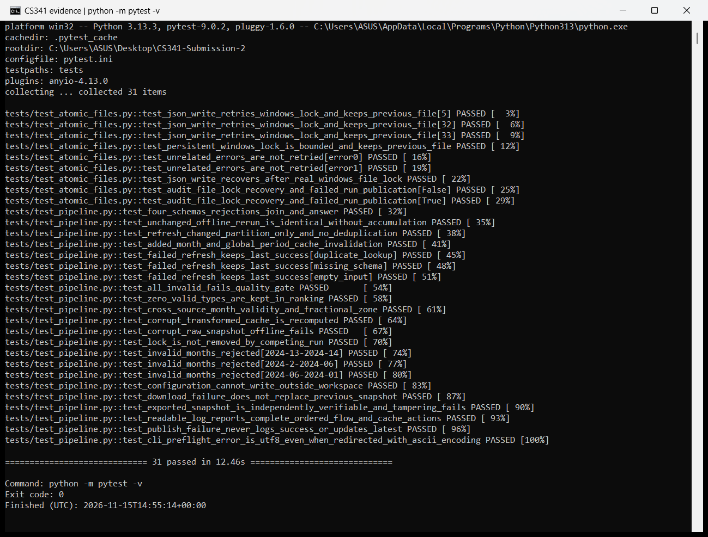
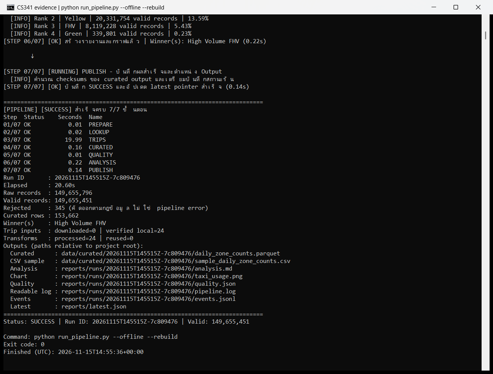
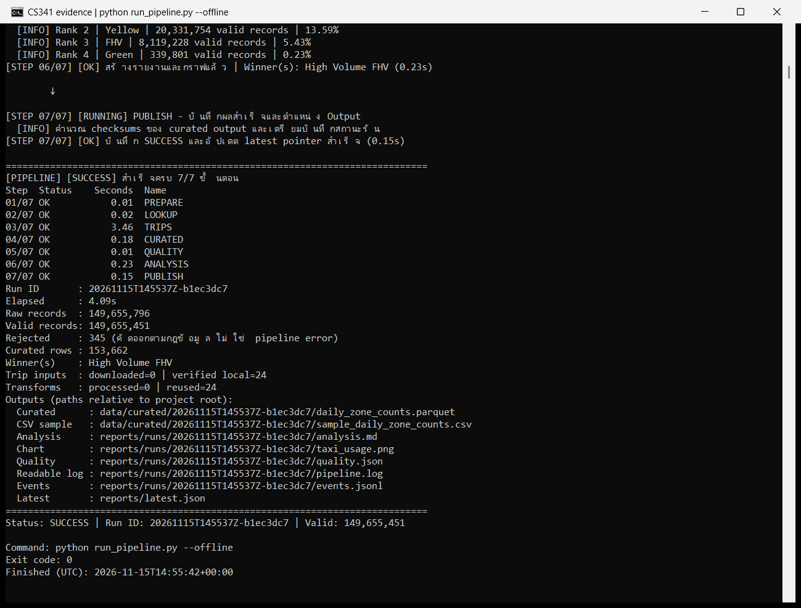
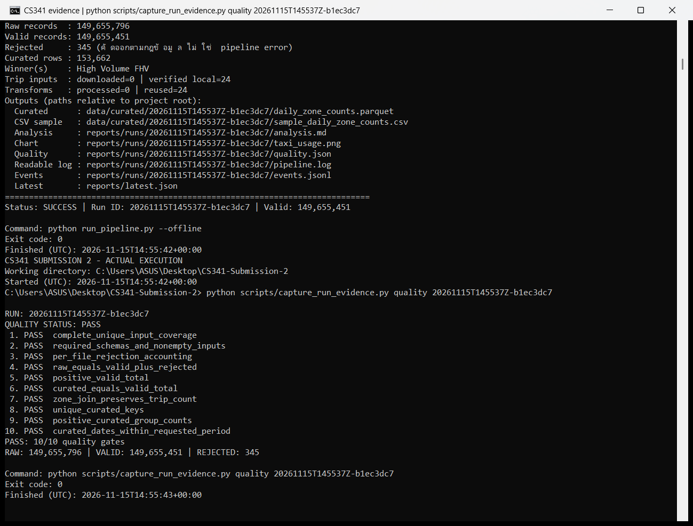
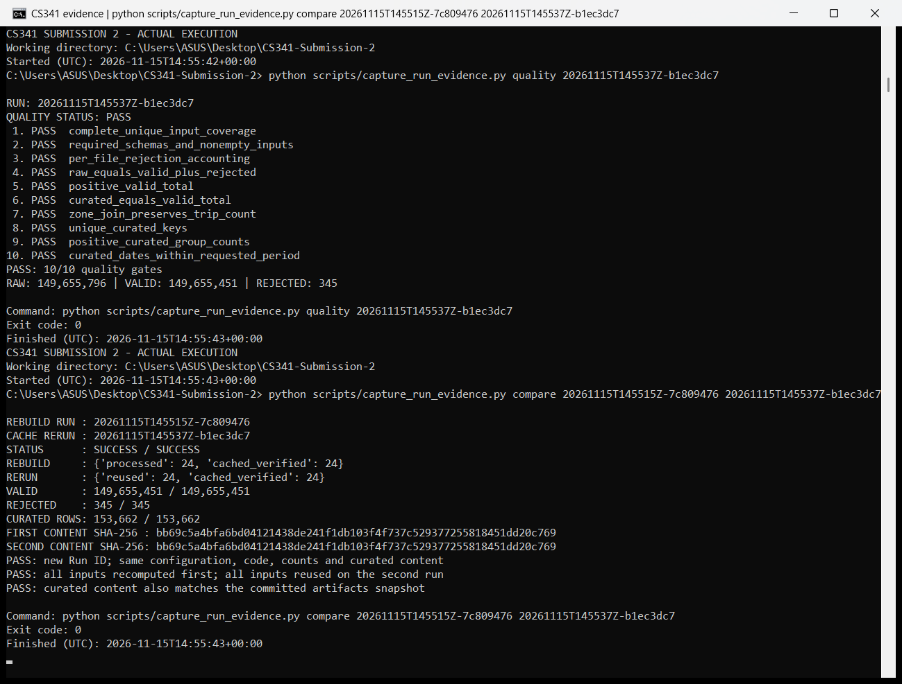
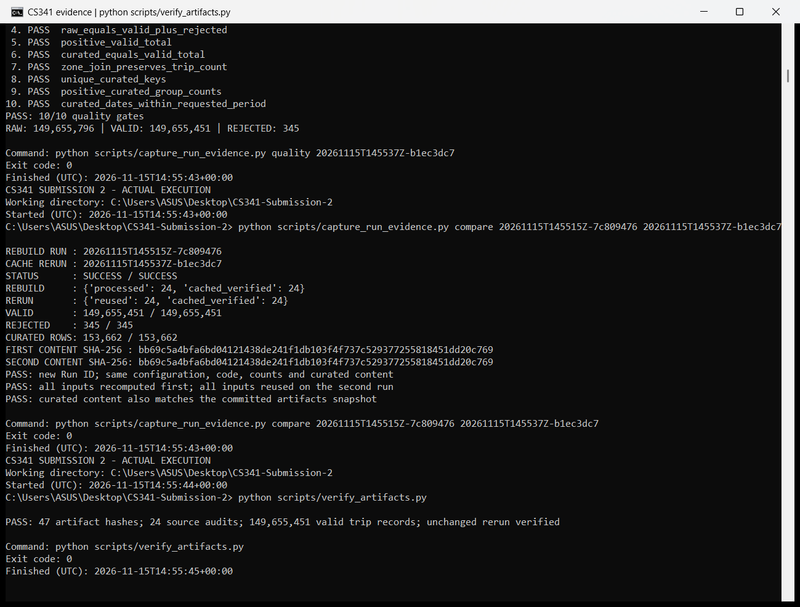

# ภาพแคปหลักฐานการรัน

ชุดนี้บันทึกจากการรันบนเครื่อง Windows ของผู้จัดทำ วันที่ **15 พฤศจิกายน 2569 เวลา 21:55 น. ตามเวลาไทย (UTC+7)** โดยมี Codex ช่วยเรียกคำสั่งและจับภาพหน้าต่างคอนโซลจริง แต่ละภาพมีชื่อคำสั่ง ผลลัพธ์ และ exit code ของ process กำกับ เวลาในหน้าคอนโซลและไฟล์ JSON เป็น UTC

## ภาพรวมผลการรัน

| หลักฐาน | ผลที่ได้ |
|---|---|
| Tests อัตโนมัติ | **31 passed**, exit code 0 |
| Pipeline รอบคำนวณใหม่ | สำเร็จ **7/7 ขั้น**, `processed=24` |
| Pipeline รอบใช้ cache | สำเร็จ **7/7 ขั้น**, `reused=24` |
| ตรวจคุณภาพ | **PASS 10/10 เงื่อนไข** |
| เปรียบเทียบสองรอบ | Run ID ต่างกัน แต่จำนวนข้อมูลและ curated content SHA-256 ตรงกัน |
| ตรวจ artifacts ที่แนบใน repository | **PASS: 47 artifact hashes; 24 source audits** |

| ตัวชี้วัด | รอบคำนวณใหม่ | รอบใช้ cache |
|---|---:|---:|
| Raw records | 149,655,796 | 149,655,796 |
| Valid records | 149,655,451 | 149,655,451 |
| Rejected records | 345 | 345 |
| Curated rows | 153,662 | 153,662 |
| เวลา pipeline | 20.599 วินาที | 4.092 วินาที |

รอบในภาพเป็นการรันใหม่จากข้อมูลดิบในเครื่อง ค่าแฮชของเนื้อหา curated ตรงกับ snapshot ใน [`artifacts/`](../../artifacts/) จึงตรวจเทียบกับชุดข้อมูลพร้อมวิเคราะห์ที่แนบไว้ได้

## 1. Tests อัตโนมัติผ่านครบ

คำสั่ง `python -m pytest -v` จบด้วย `31 passed` และ exit code 0

[เปิดภาพขนาดเต็ม](20261115T145459Z-cb5e49/01-pytest.png) · [อ่าน output ทั้งหมด](20261115T145459Z-cb5e49/transcripts/01-pytest.txt)



## 2. รัน pipeline โดยคำนวณใหม่

คำสั่ง `python run_pipeline.py --offline --rebuild` แสดงสถานะสำเร็จครบ 7 ขั้น และ `processed=24` โดยใช้ไฟล์ต้นทางที่ผ่านการตรวจ hash ในเครื่อง

[เปิดภาพขนาดเต็ม](20261115T145459Z-cb5e49/02-rebuild.png) · [อ่าน output ทั้งหมด](20261115T145459Z-cb5e49/transcripts/02-rebuild.txt)



## 3. รันซ้ำด้วย cache

คำสั่ง `python run_pipeline.py --offline` แสดง `reused=24` และได้จำนวนข้อมูลเท่ากับรอบก่อนหน้า

[เปิดภาพขนาดเต็ม](20261115T145459Z-cb5e49/03-cache-rerun.png) · [อ่าน output ทั้งหมด](20261115T145459Z-cb5e49/transcripts/03-cache-rerun.txt)



## 4. ผลตรวจคุณภาพของรอบที่รันจริง

คำสั่ง `python scripts/capture_run_evidence.py quality <run_id>` อ่าน `quality.json` ของรอบใช้ cache ตรวจสถานะ และแสดงชื่อเงื่อนไขทั้ง 10 ข้อ ซึ่งผ่านทั้งหมด

[เปิดภาพขนาดเต็ม](20261115T145459Z-cb5e49/04-quality.png) · [อ่าน output ทั้งหมด](20261115T145459Z-cb5e49/transcripts/04-quality.txt)



## 5. ผลลัพธ์เหมือนเดิมเมื่อรันซ้ำ

คำสั่ง `python scripts/capture_run_evidence.py compare <first_run> <second_run>` ตรวจสถานะ การใช้ cache การตั้งค่า โค้ด จำนวนข้อมูล และค่าแฮชของทั้งสองรอบ รวมถึงเทียบเนื้อหา curated กับ snapshot ใน `artifacts/`

[เปิดภาพขนาดเต็ม](20261115T145459Z-cb5e49/05-reproducibility.png) · [อ่าน output ทั้งหมด](20261115T145459Z-cb5e49/transcripts/05-reproducibility.txt)



## 6. ตรวจไฟล์หลักฐานใน repository

คำสั่ง `python scripts/verify_artifacts.py` ตรวจ snapshot ใน `artifacts/` และแสดง PASS ทั้ง hash ของไฟล์ ยอดรวมจาก curated และหลักฐานการรันซ้ำ

[เปิดภาพขนาดเต็ม](20261115T145459Z-cb5e49/06-verify-artifacts.png) · [อ่าน output ทั้งหมด](20261115T145459Z-cb5e49/transcripts/06-verify-artifacts.txt)



## ตรวจสอบย้อนกลับ

- รอบคำนวณใหม่: [`20261115T145515Z-7c809476`](20261115T145459Z-cb5e49/runs/20261115T145515Z-7c809476/run.json)
- รอบใช้ cache: [`20261115T145537Z-b1ec3dc7`](20261115T145459Z-cb5e49/runs/20261115T145537Z-b1ec3dc7/run.json)
- [Log และรายงานของสองรอบ](20261115T145459Z-cb5e49/runs/) มี `run.json`, `quality.json`, `pipeline.log` และ `events.jsonl` ซึ่งคัดลอกจากผลรันจริง
- [ข้อมูลกำกับการจับภาพ](20261115T145459Z-cb5e49/session.json) บันทึกคำสั่ง เวลา exit code รหัส commit ก่อนเพิ่มหลักฐาน และ SHA-256 ของ PNG, transcript และสำเนารายงาน รวม 20 ไฟล์
- [สคริปต์ที่ใช้จับภาพ](../../scripts/capture_run_evidence.py) รอผลจาก process จริงก่อนจับพิกเซลหน้าต่างคอนโซลด้วย Win32 `PrintWindow` และบันทึกเป็น PNG

ค่า `curated_content_sha256` ของทั้งสองรอบ:

```text
bb69c5a4bfa6bd04121438de241f1db103f4f737c529377255818451dd20c769
```

Paths ใน `run.json` อ้างถึงตำแหน่งทำงานในเครื่อง สำเนารายงานและ log สำหรับเปิดจาก GitHub อยู่ในโฟลเดอร์ `runs/` ของชุดภาพนี้ ส่วน curated ฉบับเต็มที่มีเนื้อหาตรงกันอยู่ใน [`artifacts/curated/`](../../artifacts/curated/)

## สร้างชุดภาพใหม่บน Windows

ติดตั้ง dependencies และเตรียมข้อมูลดิบตาม README หลักก่อน จากโฟลเดอร์โปรเจกต์ รันใน PowerShell:

```powershell
$session = [DateTime]::UtcNow.ToString('yyyyMMddTHHmmssZ')
conhost.exe python scripts/capture_run_evidence.py capture "docs/evidence/$session"
```

คำสั่งนี้เปิดคอนโซลสำหรับรัน tests, rebuild, cache rerun และตรวจผลตามลำดับ พร้อมเก็บภาพ log และ `session.json` ไว้ในโฟลเดอร์ใหม่ เมื่อสำเร็จ `session.json` จะมี `status: SUCCESS` และ exit code ของทุกคำสั่งเป็น 0
